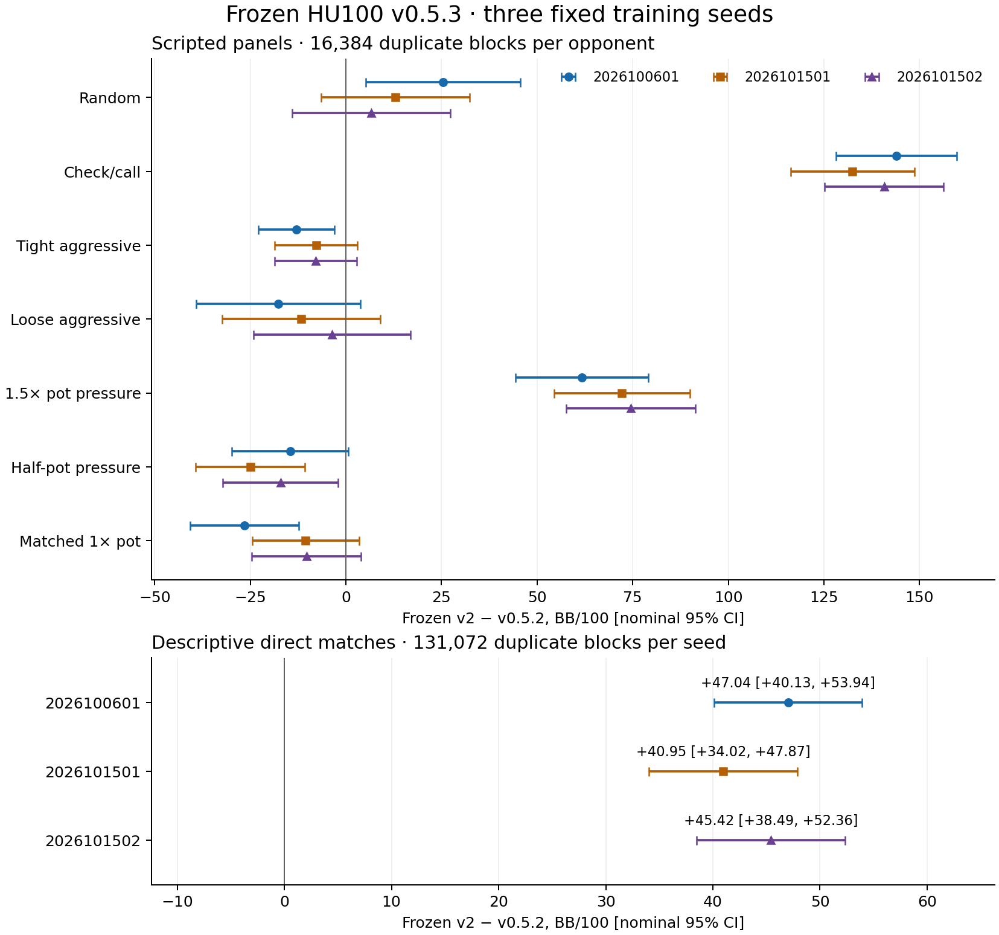

# HU100 frozen v0.5.3: three-seed readout

All **17 comparisons /1,703,936 original final hands** independently replayed and exactly reproduced before this readout. The nine comparisons from merged [#286](https://github.com/dberweger2017/CFR-NLHE-6max/pull/286) were reused unchanged; [#296](https://github.com/dberweger2017/CFR-NLHE-6max/pull/296) completes only the eight never-started comparisons. Cost-only pilots remain disjoint and unpooled. [Global barrier](hu100-v053-completion-artifacts/global-barrier.json), [complete summary](hu100-v053-completion-artifacts/summary.json).

This is the owner-authorized completion of the frozen plan after its preventive disk stop. It changes only the operational envelope. No policy, root, count, table, translation, interval or scientific script changed; no failed hand was rerun. The original [training/audit report](hu100-v053-three-seeds.md) and [protocol](../hu100-v053-three-seeds-protocol.md) remain the lineage record.

## Scripted panels

Paired frozen-v2 minus released-v0.5.2 BB/100 [nominal Student-t 95%], 16,384 duplicate blocks per opponent. V2 translation off; release translation on, 512 states/128 events. Seed 2026100601 is the already published #272 panel; the other two panels are #286’s predeclared replications.

| Opponent | 2026100601 (#272) | 2026101501 | 2026101502 |
|---|---:|---:|---:|
| random | +25.39 [+5.24, +45.54] | +13.00 [-6.40, +32.40] | +6.66 [-14.04, +27.36] |
| check_call | +143.90 [+128.09, +159.71] | +132.47 [+116.30, +148.63] | +140.73 [+125.21, +156.26] |
| tight_aggressive | -12.95 [-22.90, -3.01] | -7.80 [-18.64, +3.05] | -7.84 [-18.57, +2.88] |
| loose_aggressive | -17.75 [-39.21, +3.71] | -11.66 [-32.28, +8.96] | -3.61 [-24.15, +16.94] |
| pot_pressure | +61.76 [+44.42, +79.11] | +72.15 [+54.40, +89.90] | +74.49 [+57.58, +91.39] |
| half_pot_pressure | -14.59 [-29.77, +0.59] | -25.00 [-39.28, -10.72] | -17.10 [-32.13, -2.07] |
| matched_pot_pressure | -26.57 [-40.79, -12.34] | -10.52 [-24.53, +3.48] | -10.31 [-24.61, +3.99] |

Check/call and 1.5× pot-pressure contrasts have intervals above zero for all three seeds. Both new half-pot contrasts have intervals below zero; their tight- and loose-aggressive contrasts have negative point estimates with intervals spanning zero. The original seed’s matched-pot contrast is negative with an interval below zero, while both replications span zero. These are per-comparison facts, without an overall package verdict.

The historical #272 rule asks whether no opponent contrast has an upper bound below −20 BB/100 and whether pot_pressure has a lower bound above −20. Calculations use unrounded intervals. This comparison is not a release gate; absence of an upper-bound flag does not establish 20-BB/100 non-inferiority.

| Seed | Historical #272 rule | Upper <−20 flags | pot_pressure lower |
|---|---|---|---:|
| 2026100601 | met | none | +44.4203 |
| 2026101501 | met | none | +54.3982 |
| 2026101502 | met | none | +57.5785 |

## Descriptive direct matches

Fresh frozen v2 minus released v0.5.2 with translation 512/128 on for the release and off for v2, 131,072 duplicate blocks per seed. These contrasts are descriptive and have no decision threshold.

| Seed | BB/100 [95%] | Blocks |
|---|---:|---:|
| 2026100601 | +47.04 [+40.13, +53.94] | 131,072 |
| 2026101501 | +40.95 [+34.02, +47.87] | 131,072 |
| 2026101502 | +45.42 [+38.49, +52.36] | 131,072 |

All intervals are conditional on the fixed policy pair and training seed. They quantify deal variation, not a population interval over training seeds. Neither these scripted opponents nor the cross-menu direct match establish external-bot, multiplayer or exploitability performance. No release verdict is assigned; the owner judges the overall package.

## Reached support

Coverage is independently checked against the policy key actually selected after translation. Exact native-key support is retained separately. The direct table below reports both sides across all three seeds. Missing percentages use all decisions for that policy/street. “Positive selected” excludes both missing and zero-mass keys. Zero-visit selected keys can still have opponent-sampled average mass.

| Direct seed | Policy | Street | Decisions | Native missing | Selected missing | Selected zero mass | Positive selected |
|---|---|---|---:|---:|---:|---:|---:|
| 2026100601 | v2-2026100601 | preflop | 271,428 | 0.02% | 0.02% | 0.00% | 99.98% |
| 2026100601 | v2-2026100601 | flop | 154,989 | 0.11% | 0.11% | 0.00% | 99.89% |
| 2026100601 | v2-2026100601 | turn | 94,724 | 1.29% | 1.29% | 0.01% | 98.71% |
| 2026100601 | v2-2026100601 | river | 53,305 | 7.93% | 7.93% | 0.03% | 92.04% |
| 2026100601 | v052 | preflop | 274,089 | 7.82% | 0.69% | 0.01% | 99.30% |
| 2026100601 | v052 | flop | 162,893 | 17.36% | 1.97% | 0.00% | 98.03% |
| 2026100601 | v052 | turn | 96,737 | 26.74% | 4.62% | 0.01% | 95.37% |
| 2026100601 | v052 | river | 55,243 | 36.56% | 8.16% | 0.01% | 91.84% |
| 2026101501 | v2-2026101501 | preflop | 271,120 | 0.03% | 0.03% | 0.00% | 99.97% |
| 2026101501 | v2-2026101501 | flop | 154,672 | 0.11% | 0.11% | 0.00% | 99.89% |
| 2026101501 | v2-2026101501 | turn | 95,566 | 1.25% | 1.25% | 0.00% | 98.75% |
| 2026101501 | v2-2026101501 | river | 53,878 | 7.86% | 7.86% | 0.04% | 92.11% |
| 2026101501 | v052 | preflop | 274,096 | 8.30% | 0.67% | 0.01% | 99.32% |
| 2026101501 | v052 | flop | 161,227 | 17.39% | 1.83% | 0.00% | 98.17% |
| 2026101501 | v052 | turn | 97,886 | 26.24% | 4.43% | 0.01% | 95.56% |
| 2026101501 | v052 | river | 55,824 | 35.99% | 7.90% | 0.01% | 92.09% |
| 2026101502 | v2-2026101502 | preflop | 271,496 | 0.03% | 0.03% | 0.00% | 99.97% |
| 2026101502 | v2-2026101502 | flop | 155,584 | 0.11% | 0.11% | 0.00% | 99.89% |
| 2026101502 | v2-2026101502 | turn | 95,988 | 1.30% | 1.30% | 0.01% | 98.69% |
| 2026101502 | v2-2026101502 | river | 53,506 | 7.94% | 7.94% | 0.04% | 92.02% |
| 2026101502 | v052 | preflop | 273,637 | 8.28% | 0.70% | 0.01% | 99.29% |
| 2026101502 | v052 | flop | 162,617 | 17.77% | 1.91% | 0.00% | 98.09% |
| 2026101502 | v052 | turn | 98,066 | 26.59% | 4.31% | 0.01% | 95.68% |
| 2026101502 | v052 | river | 55,688 | 36.30% | 7.93% | 0.01% | 92.06% |

In these direct matches, v2’s river selected-key miss share is 7.86–7.94%. The release’s exact-native river miss share is 35.99–36.56%, while its post-translation selected-key miss share is 7.90–8.16%. The native and selected figures describe the same observed decisions, using different support definitions.

Selected-key visit bands (0,1–9,10–99,100+) for all final comparisons, both policies and every street are retained in the [coverage CSV](hu100-v053-completion-artifacts/coverage.csv) and complete summary. The following direct-match bands are percentages over selected **stored** keys; missing decisions are removed from the zero-visit band.

| Seed | Policy | Street | Stored selected | 0 visits | 1–9 | 10–99 | 100+ |
|---|---|---|---:|---:|---:|---:|---:|
| 2026100601 | v2-2026100601 | preflop | 271,364 | 0.00% | 0.09% | 1.66% | 98.26% |
| 2026100601 | v2-2026100601 | flop | 154,816 | 0.01% | 0.30% | 4.18% | 95.50% |
| 2026100601 | v2-2026100601 | turn | 93,504 | 0.11% | 2.11% | 14.44% | 83.33% |
| 2026100601 | v2-2026100601 | river | 49,077 | 0.78% | 7.60% | 32.50% | 59.13% |
| 2026100601 | v052 | preflop | 272,191 | 0.00% | 0.00% | 0.27% | 99.72% |
| 2026100601 | v052 | flop | 159,684 | 0.01% | 0.08% | 0.71% | 99.21% |
| 2026100601 | v052 | turn | 92,263 | 0.06% | 0.57% | 3.93% | 95.44% |
| 2026100601 | v052 | river | 50,736 | 0.05% | 0.94% | 5.66% | 93.34% |
| 2026101501 | v2-2026101501 | preflop | 271,048 | 0.00% | 0.08% | 1.55% | 98.38% |
| 2026101501 | v2-2026101501 | flop | 154,506 | 0.01% | 0.33% | 4.00% | 95.66% |
| 2026101501 | v2-2026101501 | turn | 94,369 | 0.11% | 2.00% | 14.61% | 83.28% |
| 2026101501 | v2-2026101501 | river | 49,644 | 0.81% | 7.66% | 32.01% | 59.52% |
| 2026101501 | v052 | preflop | 272,267 | 0.00% | 0.00% | 0.26% | 99.73% |
| 2026101501 | v052 | flop | 158,276 | 0.01% | 0.07% | 0.76% | 99.16% |
| 2026101501 | v052 | turn | 93,547 | 0.03% | 0.65% | 3.97% | 95.35% |
| 2026101501 | v052 | river | 51,413 | 0.06% | 1.03% | 5.82% | 93.09% |
| 2026101502 | v2-2026101502 | preflop | 271,420 | 0.00% | 0.08% | 1.59% | 98.32% |
| 2026101502 | v2-2026101502 | flop | 155,413 | 0.01% | 0.32% | 4.15% | 95.52% |
| 2026101502 | v2-2026101502 | turn | 94,738 | 0.13% | 2.12% | 14.54% | 83.21% |
| 2026101502 | v2-2026101502 | river | 49,260 | 0.76% | 7.60% | 32.57% | 59.08% |
| 2026101502 | v052 | preflop | 271,714 | 0.00% | 0.00% | 0.25% | 99.75% |
| 2026101502 | v052 | flop | 159,516 | 0.01% | 0.09% | 0.77% | 99.14% |
| 2026101502 | v052 | turn | 93,835 | 0.04% | 0.55% | 4.00% | 95.40% |
| 2026101502 | v052 | river | 51,273 | 0.05% | 0.99% | 5.74% | 93.21% |

## Absolute panel returns

BB/100 [95%] for each arm. Paired contrasts above use shared deals/role streams; their uncertainty is not obtained by subtracting arm interval limits.

| Seed | Opponent | Frozen v2 | v0.5.2 translation on |
|---|---|---:|---:|
| 2026100601 | random | +106.91 [+71.01, +142.81] | +81.51 [+45.02, +118.01] |
| 2026100601 | check_call | +268.70 [+252.02, +285.37] | +124.80 [+114.18, +135.42] |
| 2026100601 | tight_aggressive | +37.29 [+27.87, +46.71] | +50.25 [+41.64, +58.85] |
| 2026100601 | loose_aggressive | +34.87 [+15.09, +54.65] | +52.62 [+36.12, +69.12] |
| 2026100601 | pot_pressure | +27.24 [+15.27, +39.21] | -34.53 [-50.24, -18.81] |
| 2026100601 | half_pot_pressure | +16.18 [+2.60, +29.75] | +30.76 [+18.87, +42.66] |
| 2026100601 | matched_pot_pressure | +20.46 [+7.61, +33.30] | +47.02 [+35.53, +58.52] |
| 2026101501 | random | +117.23 [+81.17, +153.29] | +104.23 [+67.84, +140.62] |
| 2026101501 | check_call | +258.80 [+241.57, +276.03] | +126.33 [+115.58, +137.09] |
| 2026101501 | tight_aggressive | +35.45 [+25.61, +45.30] | +43.25 [+34.61, +51.88] |
| 2026101501 | loose_aggressive | +48.32 [+29.50, +67.14] | +59.98 [+43.71, +76.25] |
| 2026101501 | pot_pressure | +20.27 [+7.92, +32.63] | -51.88 [-67.99, -35.76] |
| 2026101501 | half_pot_pressure | +14.10 [+1.17, +27.03] | +39.10 [+28.14, +50.06] |
| 2026101501 | matched_pot_pressure | +36.05 [+23.82, +48.28] | +46.57 [+35.02, +58.12] |
| 2026101502 | random | +106.21 [+70.02, +142.40] | +99.55 [+62.80, +136.29] |
| 2026101502 | check_call | +260.51 [+244.14, +276.87] | +119.77 [+109.13, +130.41] |
| 2026101502 | tight_aggressive | +36.65 [+26.64, +46.66] | +44.49 [+35.89, +53.10] |
| 2026101502 | loose_aggressive | +56.73 [+37.74, +75.72] | +60.33 [+44.22, +76.45] |
| 2026101502 | pot_pressure | +25.86 [+14.14, +37.58] | -48.63 [-64.19, -33.07] |
| 2026101502 | half_pot_pressure | +28.53 [+15.51, +41.55] | +45.63 [+34.46, +56.80] |
| 2026101502 | matched_pot_pressure | +32.40 [+19.42, +45.38] | +42.71 [+31.39, +54.03] |

## Operations, failures and evidence

The [prospective operational envelope](hu100-v053-completion-artifacts/operational-envelope.json) and [exact PR-description readback](hu100-v053-completion-artifacts/envelope-posted.json) preceded all new final hands. The 10,102-second cap derives from the original eight pilot costs, separate one-off input/cache preparation, 1.25 margin and 1,800-second closeout. Deadline: October15 16:50:09 UTC. No new pilot or sample-size choice was made.

All prior caches were already absent following #286’s recorded terminal retirement. No file was removed for this completion. The seed2 average was restored from its accepted average-only ZIP and verified against the frozen SHA256. Both required caches were rebuilt; the release cache remains. Models, checkpoints, prior evidence and synced folders were preserved. A clean detached exact-source checkout avoids modifying #286’s later report edits. [Setup observations](hu100-v053-completion-artifacts/setup-observations.json), [input restoration](hu100-v053-completion-artifacts/input-restoration.json), [disk admission](hu100-v053-completion-artifacts/disk-admission.json), [cache state](hu100-v053-completion-artifacts/cache-retirement-state.json), [cleanup receipt](hu100-v053-completion-artifacts/cleanup-receipt.json).

All **743 five-second resource readings** are retained:739 scientific/preparation samples in the evidence ZIP, two closed evidence-archive samples in the lifecycle ZIP, and the lifecycle archive's own final two samples in the compact [M4 release receipt](hu100-v053-completion-artifacts/m4-released.json). Sampled peak family RSS **7.840 GiB**, minimum free memory **53%**, minimum free disk **56.506 GiB**, maximum fixed-baseline swap growth **0 bytes**, pressure level **1** throughout; **zero sampled breaches or stops**. The same baseline and limits cover preparation, evaluation and archival CPU. [Final resource summary](hu100-v053-completion-artifacts/final-resource-summary.json).

The eight new comparisons used **289.857s fixed setup +1920.813s block work**, versus quoted 296.478s +4911.656s. Separate cache builds took 425.011s and 300.780s. The guarded preparation/evaluation worker closed after 3713.276s. All local archival CPU finished and both locks were verified free **October15 at15:10:38UTC /17:10:38CEST**, with **56.510 GiB free**. Both ETAs and actual machine release were posted and read back in the PR. [Exact per-comparison roots/counts/input/translation/replay/reproduction checks](hu100-v053-completion-artifacts/final-verification-summary.json), [ETA record](hu100-v053-completion-artifacts/eta-20261015-1433.json), [revised ETA](hu100-v053-completion-artifacts/eta-20261015-1459.json).

The **144-member evidence ZIP (635,934,911 bytes)** and **11-member lifecycle ZIP (38,620 bytes)** have embedded manifests and complete local member size/SHA256 readback. Both have confirmed native uploaded/no-pending/no-conflicts/exact-size status and independent Drive ID/name/size/direct-parent acceptance. Remote ZIP bytes were not downloaded or verified. Local integrity and upload acceptance are separate checks. The earlier native upload-pending observation is preserved. [Archive catalog](hu100-v053-completion-artifacts/archive-catalog.json), [whole/manifest hashes, Drive locators and restore commands](../../RESULTS_INDEX.md#pr296--frozen-hu100-v053-completion-and-three-seed-readout).

No new scientific or archival failure occurred. The initial metadata/setup observations are preserved, and no final hand was rerun. Validation includes the prospective root/count/cost/SHA checks, unchanged scientific source and table/model pins, all 17 independent replay/exact reproduction receipts, raw-file hash revalidation, unchanged prior-nine sizes/mtimes/hashes, and full archive member readback. The staged repository-artifact and whitespace checks pass. CSV CRLF line endings were normalized to LF after the first whitespace check; cell values are unchanged. A prose-only check refused this source-changing PR, so the required full CI applies. The static scientific plot and desktop/mobile light/dark readout were visually checked. Final-head CI validation is recorded on PR296. The original #286 preventive disk stop and setup/CI failures remain in its report and accepted archives. No release, tag, default change or merge is performed.
