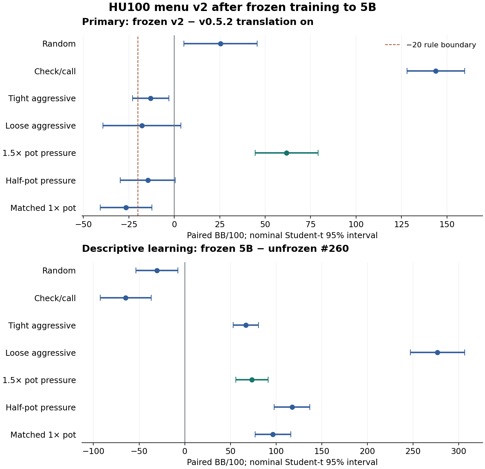

# HU100 menu v2 after frozen-table training to 5B

**Recommend this fixed-seed model as a v0.5.3 candidate under the predeclared panel rule. The owner decides.**

The paired pot-pressure contrast against released v0.5.2 with translation is
**+61.76 [+44.42, +79.11] BB/100**.
Severe primary regression flags: **none**.
Frozen continuation keeps the pressure fix and removes #260's large
aggressive-bot deficits: the fresh learning contrasts are **+66.95
[52.99,80.91]** against tight and **+276.92 [247.26,306.59] BB/100**
against loose. Smaller deficits to the release remain: tight **−12.95
[−22.90,−3.01]**, loose **−17.75 [−39.21,3.71]**. Matched 1× pot is
**−26.57 [−40.79,−12.34]**, a clear descriptive regression that passes
the requested upper-bound rule. Passing that rule does not prove every
regression is smaller than 20 BB/100.

Intervals are nominal paired Student-t 95%, conditional on the fixed policies
and training seed 2026100601. No training-seed population, external-bot,
multiplayer, exploitability, release or default claim.

## Exact continuation and audits

One change: freeze #260's exact 97,290,578-key terminal and continue to
**5,000,006,023 cumulative nodes /1,794,658 iterations**.
The absent parent was regenerated from the exact recipe and matched
**3,488,922,486 bytes**, SHA256
`202058df8aff994612b441d26ffc4e70475ee790cc06a799635e4389e219db2f`.
It was not downloaded from Drive. Resume used `--freeze-at-cap`, the actual
`--max-entries 97290578` and `--nodes 5000000000`.

HU100, seed 2026100601, R=1, linear CFR, opponent-sampled average, menu v2,
ordered history and unchanged #163 K50 tables; two 10,000-chip stacks,
50/100 blinds, no ante/rake or raise cap. Build used current-main native
source 6df0dab9 through `python -m scripts.build_native_trainer`; native
SHA256 `4f6abcbb954c3c744448c2a3542ab3164e0e1a015cb05ecebeda077525991cd4`.
[Build](hu100-v2-frozen-5b-artifacts/build-receipt.json),
[exact recovery](hu100-v2-frozen-5b-artifacts/parent-verified.json),
[training](hu100-v2-frozen-5b-artifacts/training-complete.json).

Both current and average exports use `--zero-mass uniform`.
`src.diagnostics.cfr_average.audit` verifies all **97,290,578 rows**,
stored average totals and current regrets.
[Full audit and all three file hashes](hu100-v2-frozen-5b-artifacts/5b.audit.json).

| Stored table | Mean traverser visits/key | Zero traverser visits | Zero average mass |
|---|---:|---:|---:|
| #260 terminal, 332,894,788 nodes | 0.6598 | 56.7925% | 33.8974% |
| Frozen 5B | 5.2673 | 32.6989% | 22.7751% |

The table retains its cardinality and freeze boundary at iteration 104,400.
Stored visits are **512,456,228**; discarded traverser visits
**426,560,235** and discarded merged
updates **1,092,540,595**. An update counts one
missing key's merged delta per iteration, including opponent-only deltas.
Zero traverser visits do not imply zero opponent-sampled average mass.

## Frozen training coverage

These counters cover the entire resumed frozen interval, starting at
iteration 104,400. They count counterfactual training branches, which differs
from #260's approximately 9% missing river decisions in its direct evaluation.
An opponent-only stored key is a hit even without allocated regrets.

| Street | Traverser decisions | Missing traverser | Opponent decisions | Missing opponent | Combined missing |
|---|---:|---:|---:|---:|---:|
| preflop | 23,486,340 | 7.09% | 53,625,366 | 3.50% | 4.59% |
| flop | 91,217,230 | 12.69% | 190,938,870 | 7.20% | 8.98% |
| turn | 251,806,627 | 34.74% | 468,857,045 | 24.18% | 27.87% |
| river | 508,317,402 | 64.10% | 963,422,845 | 56.66% | 59.23% |

Retained keys are denser, but deep-street training support remains incomplete.
Missing keys play uniformly for both players forever, so this is CFR on a
restricted game. These coverage figures are descriptive and do not add a
strength gate or establish convergence in the original game.

## Primary scripted panel

Frozen v2 translation off versus released v0.5.2 translation 512 states /128
events on. Each opponent uses shared deals and role RNGs across arms, with
rotated seats and independent duplicate blocks. Both half-pot and matched 1×
pot bettors are supported by the HU100 harness and are included.

| Opponent | Frozen 5B BB/100 [95%] | v0.5.2 on [95%] | Paired frozen−release [95%] | Upper<−20 flag |
|---|---:|---:|---:|---|
| Random | +106.91 [+71.01, +142.81] | +81.51 [+45.02, +118.01] | +25.39 [+5.24, +45.54] | no |
| Check/call | +268.70 [+252.02, +285.37] | +124.80 [+114.18, +135.42] | +143.90 [+128.09, +159.71] | no |
| Tight aggressive | +37.29 [+27.87, +46.71] | +50.25 [+41.64, +58.85] | -12.95 [-22.90, -3.01] | no |
| Loose aggressive | +34.87 [+15.09, +54.65] | +52.62 [+36.12, +69.12] | -17.75 [-39.21, +3.71] | no |
| 1.5× pot pressure | +27.24 [+15.27, +39.21] | -34.53 [-50.24, -18.81] | +61.76 [+44.42, +79.11] | no |
| Half-pot pressure | +16.18 [+2.60, +29.75] | +30.76 [+18.87, +42.66] | -14.59 [-29.77, +0.59] | no |
| Matched 1× pot pressure | +20.46 [+7.61, +33.30] | +47.02 [+35.53, +58.52] | -26.57 [-40.79, -12.34] | no |

**Decision:** Recommend this fixed-seed model as a v0.5.3 candidate under the predeclared panel rule. The predeclared rule requires no primary upper
bound below −20 BB/100 and a pot-pressure lower bound greater than −20.
The calculation uses unrounded limits. Absence of an upper-bound flag does
not establish 20 BB/100 non-inferiority for the other opponents.

## Descriptive learning check

Frozen 5B minus #260's audited unfrozen terminal, on the same panel/deals.
The frozen candidate's block returns agree exactly between this panel and
the primary panel. This assesses continued learning on the fixed table;
there is no expanding-table 5B control or second training seed.

| Opponent | Unfrozen terminal BB/100 [95%] | Paired frozen−unfrozen [95%] |
|---|---:|---:|
| Random | +137.50 [+101.48, +173.52] | -30.59 [-53.54, -7.65] |
| Check/call | +333.33 [+302.74, +363.92] | -64.63 [-92.69, -36.58] |
| Tight aggressive | -29.66 [-43.82, -15.50] | +66.95 [+52.99, +80.91] |
| Loose aggressive | -242.05 [-270.72, -213.39] | +276.92 [+247.26, +306.59] |
| 1.5× pot pressure | -46.39 [-64.36, -28.43] | +73.63 [+55.96, +91.30] |
| Half-pot pressure | -101.34 [-120.97, -81.70] | +117.51 [+97.89, +137.13] |
| Matched 1× pot pressure | -76.17 [-95.65, -56.69] | +96.63 [+77.09, +116.16] |

The −20 line marks the requested primary rule boundary: a regression flag
requires the interval's upper limit to be left of that line. No primary
interval meets that condition. The pot-pressure lower limit is greater
than −20. All intervals are conditional on this fixed seed and policy pair.

## Descriptive direct match and support

Frozen v2 minus released v0.5.2, translation off for both:
**+172.19 [+163.85, +180.54] BB/100**, 131,072 duplicate
blocks. Each model owns its schema and tables. Cross-menu missing keys,
especially on the v1 side, limit interpretation as a general strength result;
this direct contrast has no role in the candidate decision.
Frozen v2's river miss share is **8.63%**, versus **31.48%** for v0.5.2.
Thus played river decisions mostly have stored support, while the broader
counterfactual river training tree still has frequent misses. This run
answers the requested frozen 5B case; it does not establish a fully dense
original-game policy.

| Policy/street | Decisions | Missing key | Zero mass | Positive mass |
|---|---:|---:|---:|---:|
| v052/flop | 162,621 | 28,114 (17.29%) | 3 | 134,504 |
| v052/preflop | 276,787 | 24,157 (8.73%) | 28 | 252,602 |
| v052/river | 51,276 | 16,140 (31.48%) | 5 | 35,131 |
| v052/turn | 93,663 | 22,974 (24.53%) | 9 | 70,680 |
| v2-frozen-5b/flop | 159,329 | 245 (0.15%) | 5 | 159,079 |
| v2-frozen-5b/preflop | 278,621 | 106 (0.04%) | 1 | 278,514 |
| v2-frozen-5b/river | 51,037 | 4,407 (8.63%) | 27 | 46,603 |
| v2-frozen-5b/turn | 93,863 | 1,321 (1.41%) | 9 | 92,533 |

## Prospective costs and verification

Cost-only pilots: 1,024 direct blocks and 64 per comparison/opponent,
with disjoint final roots. Only costs and paired SDs were exposed before
freezing the plan; no pilot outcomes are pooled into final estimates.

One-off preparation took **31.76 minutes**, including
parent-average export, release/input verification and the three cache builds.
At selected final counts, repeated model/cache/table loading and input hash
checks project **8.16 minutes**; block-dependent
play, raw-trace hashing, independent replay and reproduction project
**54.04 minutes**. Only block work is scaled.
The whole projection includes elapsed work, 25% future-work margin and 30
minutes for closeout: **4.470 hours**.
Actual final comparisons took **8.49 minutes fixed** plus **41.00 minutes
block-dependent work**. The whole campaign through local archive closeout
took **3h31m41s**, within the original seven-hour budget.
[Measured costs](hu100-v2-frozen-5b-artifacts/final-costs-summary.json).

Selected **16,384 blocks/opponent per panel** and
**131,072 direct blocks**. All **1,179,648 final original hands**
independently replay and exactly reproduce before readout; reproduction
adds no independent sample. [Canonical plan](hu100-v2-frozen-5b-artifacts/canonical-plan.json)
and [PR posting/readback](hu100-v2-frozen-5b-artifacts/plan-posted.json) precede
the first final hand. [Full summary/coverage](hu100-v2-frozen-5b-artifacts/summary.json).

## Guards and evidence

M4 only, detached tmux; both shared research locks held through completion.
All **2,474 five-second readings** are retained. Peak sampled
family RSS **9.453 GiB**;
minimum memory-pressure free percentage **32%**;
minimum disk **35.481 GiB**;
maximum fixed-baseline swap growth **0.560 GB**.
Pressure levels **[1, 2]**. No sustained guard stop.
There were no sampled threshold breaches. Levels 1/2 are normal/warning;
critical is level 4.
Limits: 13 GiB RSS, critical pressure, free<8%, swap growth>4 GB sustained 60s;
disk<16 GiB immediate. Creation-time identity checks precede owned-process
signals. [Closed resource summary](hu100-v2-frozen-5b-artifacts/resource-summary.json).

Training and evaluation have no scientific retries or failed-hand reruns.
The pre-hand observer admission false positive, original logs and correction
are preserved; no hand existed before correction and the original budget
and roots stayed fixed.

Full evidence, separate average-only and closed-archive-guard ZIPs have
embedded manifests and complete local member readback. Existing #260 inputs
and #163 tables are referenced rather than repacked. All three ZIPs now have native uploaded/no-pending/no-conflicts acceptance
and independent Drive ID/name/size/direct-parent confirmation. These remain
separate from local integrity checks;
remote archive bytes are not redownloaded. Archive IDs, hashes, members and
retrieval commands are in [RESULTS_INDEX](../../RESULTS_INDEX.md#pr272--hu100-v2-frozen-5b-october-14-2026).
Originals remain; no synced deletion or forced offloading.

The M4 was confirmed released **October 14 at 17:09 CEST /15:09 UTC**:
no campaign workers and both research locks free.
[Release confirmation](hu100-v2-frozen-5b-artifacts/release-confirmation.json).

Focused harness, guard and direct-play tests: **21 passed**. The staged
repository artifact check passes. Final CI and owner review are tracked on
[PR272](https://github.com/dberweger2017/CFR-NLHE-6max/pull/272).

No release, tag, default change or merge. The owner decides.
