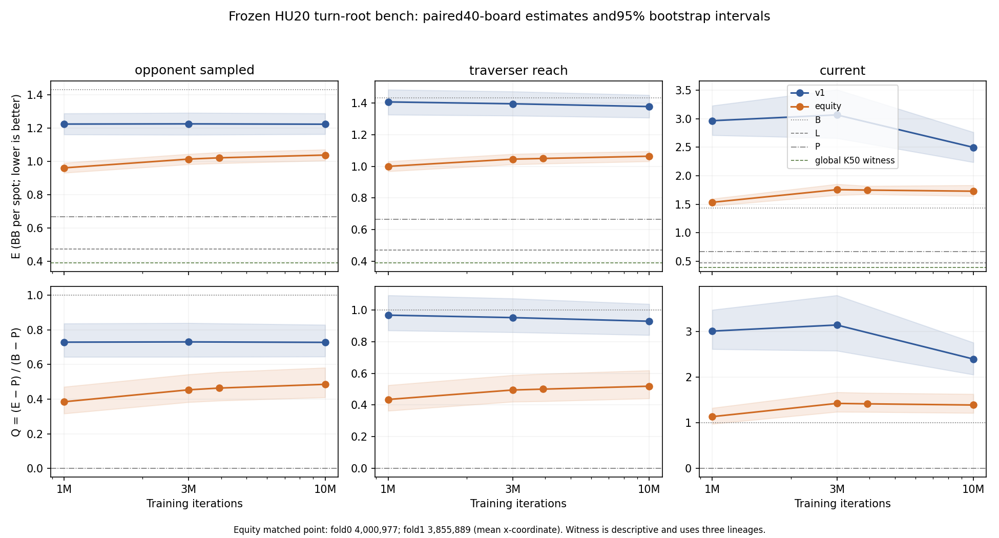

# Fresh M4 frozen K50 scoring: pass

**Pass under #222's frozen rule.** Across all 40 held-out roots, matched-visit K50 opponent-sampled loss minus v1 at 3M is **−0.2038 BB**, paired 95% bootstrap **[−0.2836, −0.1274]**. Its upper bound is below −0.10 BB. The 10M contrast is **−0.1853 BB** (descriptive interval [−0.2589, −0.1117]), satisfying the required negative point estimate. This resolves abstraction step 3 on the fixed turn-root bench and supports proceeding to full-game confirmation.

This is the owner-authorized new M4 all-40 attempt [PR232](https://github.com/dberweger2017/deepcfr-texas-no-limit-holdem-6-players/pull/232), with zero reused scores. The [frozen protocol](../hu20-equity-bench.md) and [M4 admission protocol](../hu20-equity-bench-scoring-m4.md) retain #162's 40 roots, two folds and B500M lineage 2026093001 ranges; #222's exports and references; #149's qualified lock-only evaluator; v1 labels and #190's global K50 adapter; and the original primary and bootstrap. Both seats and every exported policy were scored. Bootstrap: 2,000 paired board draws in sorted spot order, Python Random seed 202610050002, percentile indices 49/1949. No sample, checkpoint, label, reference or decision-rule adjustment followed outcomes.

Earlier #222 visibility, #225 pressure and #230 AC stops remain preserved in their reports and accepted archives. Nine M1 outcomes were inspected at the owner's request before PR232 was authorized. This completed benchmark therefore does not claim outcome blindness or an independent confirmation sample. Its new pilot outcomes were not inspected for admission, and no new partial scores were inspected while evaluation ran. The timer was disabled after all 40 plus a clear completed evaluation guard, before guarded reporting and the first new numeric readout.

## Primary and learning curves

| Opponent-sampled average | v1 E, BB [95%] | K50 E, BB [95%] | v1 Q [95%] | K50 Q [95%] |
| --- | --- | --- | --- | --- |
| 1M | 1.2244 [1.1616, 1.2884] | 0.9612 [0.9317, 0.9916] | 0.7293 [0.6441, 0.8372] | 0.3850 [0.3169, 0.4714] |
| 3M | 1.2256 [1.1601, 1.2921] | 1.0140 [0.9826, 1.0445] | 0.7308 [0.6442, 0.8399] | 0.4540 [0.3827, 0.5432] |
| Frozen matched K50 vs v1 at 3M | 1.2256 [1.1601, 1.2921] | 1.0217 [0.9889, 1.0547] | 0.7308 [0.6442, 0.8399] | 0.4641 [0.3915, 0.5563] |
| 10M | 1.2236 [1.1636, 1.2885] | 1.0383 [1.0054, 1.0714] | 0.7282 [0.6460, 0.8297] | 0.4857 [0.4104, 0.5820] |

E is BB per spot, lower better; Q = (E − P)/(B − P), computed from aggregate means with the same paired draws. Reference E values are **B 1.4313 [1.3212, 1.5364]**, **L 0.4733 [0.4345, 0.5110]**, **P 0.6670 [0.6390, 0.6973]**. All 21 exported policies, including traverser-reach averages and current policies, have E/Q intervals in the [complete table](hu20-equity-bench-scoring-m4-artifacts/final-policy-table.md) and [CSV](hu20-equity-bench-scoring-m4-artifacts/final-policy-table.csv); the CSV also records E−B, E−L, E−P and E−witness for every export. [Full frozen summary](hu20-equity-bench-scoring-m4-artifacts/final-summary.json).

The K50 opponent-sampled curve rises from 0.9612 at 1M to 1.0383 at 10M; v1 stays near 1.224. The predeclared matched rule passes despite this descriptive deterioration, and the budget was not extended or a better checkpoint selected. Fold matched point contrasts are −0.3093 and −0.0984 BB; these describe two folds of one fixed training seed. The earlier nine-root fold disagreement is preserved in its [partial analysis](hu20-equity-bench-partial-analysis.md), rather than replaced by a fresh-confirmation claim.

K50 matched E is **0.6300 BB above #190's global K50 witness E = 0.3917**; at 10M the gap is **0.6466 BB** (1M 0.5695; 3M 0.6223). That witness averages three lineages and is descriptive context, not a trained control or another decision opportunity. The passing contrast does not establish full-game strength or convergence to the witness.

## Exact inputs and resource admission

PR226 explicitly released M4 at 01:09 Madrid on October11 after its terminal archival stop. Fresh admission found no competing research. The isolated environment passed 22 focused tests, CLI qualification and the artifact checker. Main was integrated before science; executed source **d39ece2b00933dd7584daf9ff1ede82773f08241** retains all 23 exact [independently reviewed source pins](hu20-equity-bench-scoring-m4-artifacts/source-review.json). No native trainer source or model was changed or trained.

Accepted #222/#190/#163 archives restored **281 members plus 24 aliases**, with whole-archive, every-member and alias size/SHA256 checks. Preparation localized only compact file paths for 40 requests and verified 21 policies per fold. Matched iterations remain **4,000,977 /3,855,889**; actual matched-visit residuals remain **−2.321% /−1.907%**. #222's unchanged [visit distributions, key counts and bands](hu20-equity-bench-artifacts/visits.json) and [training report](hu20-equity-bench.md) retain the complete training evidence. [Restoration and archive index](../../RESULTS_INDEX.md#pr232-fresh-all-40-m4-frozen-k50-scoring).

The sole timing-only pilot completed in **356.05 guard seconds /354.20 native seconds**, peak family **4.59 GiB**. Its [full quote](https://github.com/dberweger2017/deepcfr-texas-no-limit-holdem-6-players/pull/232#issuecomment-6103758968) was posted before the once-only evaluation. All 40 completed in **14,689.52 seconds (4h04m50s)**, peak family **4.61 GiB**, with clear supervision and no cleanup error. Reporting also completed clear. The M4 identity, 7 GiB family ceiling, normal pressure, 15% free, 9 GiB scoring admission, AC, 16 GiB disk floor and owner-authorized 10 GB total-swap ceiling remained enforced, including unchanged inner swap-growth and wall guards.

One administrative pilot launcher resolved the environment symlink to base Python and failed importing psutil before the guard or pilot claimed a phase. Its immutable [receipt](hu20-equity-bench-scoring-m4-artifacts/pilot-launch-admin-failure.json) is preserved; the corrected absolute virtual-environment path launched the only scientific pilot. No failed science was retried.

## Next step and closeout

**Recommend roadmap step 4:** implement the missing K50 schema/table support in Python checkpoint and average loaders (`load_training`, `AveragePolicy`), the web/runtime path, turn search's blueprint ranges, and LBR. Then run full-game K50 lineages with learning curves, a predeclared direct match against **v0.4.2**, and the arena/scenario safeguards. The [key support report](native-equity-bucket-keys.md#not-yet-covered) identifies these gaps. This result authorizes a recommendation; no full-game run, default change or release is part of PR232.

The independent end evidence review reproduced all 40 rows, every E/Q interval, the primary/10M contrasts and all 1,680 native seat metrics exactly. Evaluation resource extrema were normal pressure, at least 76% free, max total swap 1,799,618,560 bytes, minimum disk 25,690,066,944 bytes and AC throughout. [Operation receipts and extrema](hu20-equity-bench-scoring-m4-artifacts/final-operation-summary.json).

Post-report archiving initially failed its live GitHub status query with HTTP401 on M4, before creating a ZIP. That worker-exit receipt, log, helper and failure latch remain immutable in the bundle. Its three resource samples were clear; this was an administrative archival failure, not a failed scoring pass. A separate guarded archival-only closeout used live PR state/head metadata from authenticated M1 and completed in 1.53 seconds. No scientific phase was retried. [Issue/SOMA](https://github.com/dberweger2017/deepcfr-texas-no-limit-holdem-6-players/pull/232#issuecomment-6105511793).

The [7,051,373-byte scoring ZIP](https://drive.google.com/file/d/14uWTt_Cw09qT9EkTuxaEcwC6TOuDt7dL/view) contains 430 member-hashed payloads, including every new score/native output, guard evidence, restoration/localization provenance, source/helpers and derived outputs. All members passed local readback and independent review. Already accepted #222 inputs, the #190 evaluator and #163 tables are omitted. [Archive receipt](hu20-equity-bench-scoring-m4-artifacts/final-archive-receipt.json), [native and independent cloud acceptance](hu20-equity-bench-scoring-m4-artifacts/final-cloud-upload.json). Remote ZIP bytes were not downloaded or audited. Final review/upload/cleanup/merge lifecycle receipts remain in Git, separate from the report snapshot at sealing.

After accepted upload and independent dependency clearance, only **305 own extracted input files** were removed, with immediate exact path/set/size/mtime/SHA256 and open-handle checks. [Cleanup receipt with every removed path and restoration locator](hu20-equity-bench-scoring-m4-artifacts/final-cleanup-receipt.json), [dependency review](hu20-equity-bench-scoring-m4-artifacts/cleanup-dependency-review.json), [clear cleanup guard](hu20-equity-bench-scoring-m4-artifacts/cleanup-guard.json). Prior archives, score originals, working roots and all synced folders remain retained. Historical own input symlinks require fresh hash-verified restoration before reuse. The [single final end evidence review](hu20-equity-bench-scoring-m4-artifacts/final-evidence-review.json) is clear, with no open findings; merge requires green exact-head checks.

M4 was explicitly released at **06:46 Madrid October11**, after all compute, accepted archival and scoped cleanup completed. [Release receipt](hu20-equity-bench-scoring-m4-artifacts/m4-release.json). Final CI and merge continue on M1.
