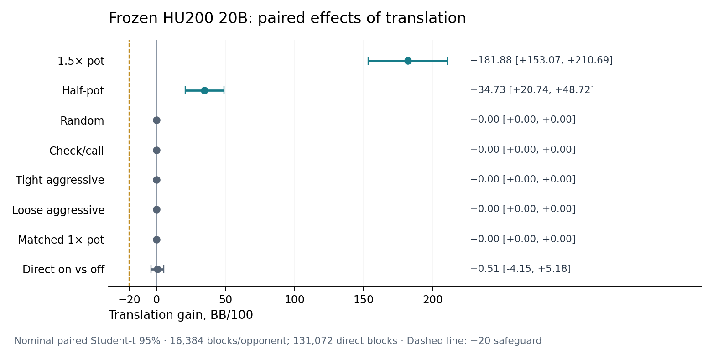

# Frozen HU200 K50 action translation

Translation removes about three quarters of the frozen 20B model’s tested 1.5× pot loss, **without a detected regression in this panel**, but it does **not** eliminate that loss. The baseline is **−242.83 [−275.79, −209.86] BB/100**; translation is **−60.95 [−86.51, −35.38]**. The paired gain is **+181.88 [153.07, 210.69]**. Half-pot also improves **+34.73 [20.74, 48.72]**. The five on-menu controls have identical play and exactly zero paired differences; direct translation-on versus off is **+0.51 [−4.15, 5.18]**.

**The predeclared Slumbot rule passes.** The 1.5× pot gain’s lower bound exceeds zero; no other panel or direct upper bound is below −20 BB/100. This recommends external confirmation of this fixed lineage, not a claim of profitability against 1.5× pot, no harm against every possible opponent, or general poker strength. The owner decides the merge; no release or default changes.

## Fixed inputs, design and verification

Scientific source `fd44d53f22c4c795d2d725f94babc065bde14f90`, based on main `cf629c8a`. Both arms use #265’s **20,000,002,032-node /85,373,907-key** average, **3,164,563,975 bytes**, SHA256 `9128f71c602f18a9cb7219b18cd43ff4e3f2b7ed6a30f9babe7ed033840ac7b6`, the same #163 pinned tables and #268’s existing cache read-only. The verified parent checkpoint is `c5929bda17457911347e47cd77a83dd8b34618a5542731bed96ece1fb4288b6f`. No training or table growth occurs. Candidate translation uses **512 states /128 events**, the released v0.5.2 settings; baseline is off. Uniform zero-mass and unresolved missing-key behavior remain.

The [protocol](../hu200-k50-translation-protocol.md), [canonical plan](hu200-k50-translation-artifacts/canonical-plan.json) and [posting readback](hu200-k50-translation-artifacts/plan-posted.json) precede all final hands. Plan SHA256 `6bafd8894609387d884eee285c5e3d0d479bfe5cfeeffa39f3599561e2b3f476`. All requested counts were kept: **131,072 direct duplicate blocks**, **16,384 paired blocks per seven opponents**, totaling **720,896 final hands**. Direct has two rotated hands per block; panel has four (two seats × two arms) on shared deals and role RNGs. HU200 resets, 50/100 blinds, 0.01 chips, no rake. Roots `20261014122101/02` are pilots, `20261014122103/04` are finals, [reserved](hu200-k50-translation-artifacts/inputs.json) against main and other open heads.

Every final hand independently replays with fresh engine state and policy-owned card tables; every selected witness also replays through legal engine actions and reproduces its key, labels, distance and flags. Complete independent match reproduction checks all actions, probabilities, keys, deterministic telemetry, public events and settlements. Only measured elapsed seconds are excluded from equality. Every raw stream is hashed and rechecked before any final readout. The [global barrier](hu200-k50-translation-artifacts/all-final-verified.json) and [separate statistics recount](hu200-k50-translation-artifacts/independent-recount.json) confirm every count, interval and decision rule. No failed hand or scientific attempt was retried.

## Paired results

Nominal paired Student-t 95% intervals over independent duplicate blocks; positive contrasts favor translation. Fixed-model uncertainty only, without multiple-comparison adjustment or training-seed variation.

| Opponent | Off BB/100 [95%] | On BB/100 [95%] | On − off [95%] |
|---|---:|---:|---:|
| 1.5× pot | -242.83 [-275.79, -209.86] | -60.95 [-86.51, -35.38] | +181.88 [+153.07, +210.69] |
| Half-pot | +26.86 [+10.18, +43.54] | +61.59 [+46.44, +76.74] | +34.73 [+20.74, +48.72] |
| Random | +120.09 [+45.52, +194.66] | +120.09 [+45.52, +194.66] | +0.00 [+0.00, +0.00] |
| Check/call | +163.06 [+150.42, +175.69] | +163.06 [+150.42, +175.69] | +0.00 [+0.00, +0.00] |
| Tight aggressive | +60.85 [+49.38, +72.32] | +60.85 [+49.38, +72.32] | +0.00 [+0.00, +0.00] |
| Loose aggressive | +115.12 [+91.49, +138.76] | +115.12 [+91.49, +138.76] | +0.00 [+0.00, +0.00] |
| Matched 1× pot | +60.68 [+45.58, +75.77] | +60.68 [+45.58, +75.77] | +0.00 [+0.00, +0.00] |

Direct duplicate on versus off: **+0.51 [-4.15, +5.18] BB/100**. Translation fires zero times there: both players stay within the same menu. On-menu scripted controls also never translate, and all their paired hands/actions match; their zero differences are exact finite-sample equality, not merely nonsignificant estimates.

## Translation telemetry and latency

Across all finals, translation selects **7,509 witnesses**. It fires only against 1.5× pot and half-pot. The following counts are decision-weighted within each arm’s reached states; playing differently changes later decision denominators. “Uniform” includes unresolved missing keys and retained zero-mass rows. Full street/mode counts, witness distance percentiles, state histograms, bounds and lookup/decision latency are in the [summary](hu200-k50-translation-artifacts/summary.json) and [CSV](hu200-k50-translation-artifacts/telemetry.csv).

| Opponent /street | On decisions | Translated | Uniform | Witness distance p50 /p90 /max | Lookup p99 ms | Decision p99 /max ms |
|---|---:|---:|---:|---:|---:|---:|
| 1.5× pot /preflop | 22,103 | 1,290 (5.84%) | 315 | 0.100 /0.100 /0.465 | 0.308 | 0.310 /1.159 |
| 1.5× pot /flop | 8,197 | 2,523 (30.78%) | 254 | 0.100 /0.200 /0.784 | 0.592 | 0.594 /2.499 |
| 1.5× pot /turn | 4,145 | 1,870 (45.11%) | 288 | 0.100 /0.209 /0.784 | 0.920 | 0.922 /2.030 |
| 1.5× pot /river | 2,364 | 1,141 (48.27%) | 431 | 0.145 /0.232 /0.713 | 1.206 | 1.208 /3.597 |
| Half-pot /preflop | 22,144 | 156 (0.70%) | 3 | 0.197 /0.458 /0.917 | 0.366 | 0.368 /1.850 |
| Half-pot /flop | 9,193 | 127 (1.38%) | 4 | 0.319 /0.623 /0.992 | 0.691 | 0.694 /2.890 |
| Half-pot /turn | 4,926 | 168 (3.41%) | 1 | 0.444 /0.667 /1.048 | 0.953 | 0.956 /1.792 |
| Half-pot /river | 2,877 | 234 (8.13%) | 7 | 0.531 /0.741 /1.225 | 1.425 | 1.428 /2.484 |

Witness distance is the existing sum of rational public bet-size distances, not BB error; it can exceed one over several raises. No search hits either work bound. All selected witnesses preserve all-in flags (zero all-in changes). Searches on unsupported on-menu missing keys still return uniform, and known/zero-mass rows never search.

Pooled measured latency on M4, including the direct match and all panels:

| Policy /mode | Decisions | Lookup mean /p99 /max ms | Decision mean /p99 /max ms |
|---|---:|---:|---:|
| frozen-off/exact | 1,097,919 | 0.035 /0.291 /2.868 | 0.037 /0.293 /2.870 |
| frozen-off/uniform | 17,740 | 0.028 /0.219 /3.163 | 0.030 /0.222 /3.165 |
| frozen-on/exact | 1,098,136 | 0.038 /0.367 /3.785 | 0.041 /0.370 /3.795 |
| frozen-on/translated | 7,509 | 0.348 /1.266 /3.595 | 0.351 /1.268 /3.597 |
| frozen-on/uniform | 10,921 | 0.224 /0.988 /3.146 | 0.226 /0.990 /3.148 |

Translated lookup averages **0.348 ms**, p99 **1.266 ms**; the maximum measured complete policy decision across all finals is **3.795 ms**. These times cover lookup/search and sampling, excluding evaluator tracing, replay, network and journaling. The on/off exact timings include cache/measurement noise and are not isolated causal overhead estimates. The observed decision cost is well inside the several-second Slumbot allowance described in the task; live service timing remains untested.

## Code and v1 identity

`AveragePolicy.configure_translation` admits HU100/HU200 menu-v1 K50 schemas, validates the policy’s pinned table identity, and records `hu100-public-menu-translation-equity-k50-v1` or `hu200-public-menu-translation-equity-k50-v1`. Every witness candidate key receives `equity_cards` explicitly. Menu v2 remains refused. The Slumbot play/analysis CLIs add `--action-translation`, `--translation-max-states` and `--translation-max-events`; versions/options are in run identities and hash-chained decision telemetry. Analysis rejects mismatched run/model translation settings and rechecks deterministic telemetry.

Fixed v1 translation-on **synthetic stored-average** matches on main and the branch each have 64 hands /256 model decisions /64 successful translations. Complete deterministic trace bytes compare equal (elapsed timings excluded). The runner freezes its tables before play, uses the same engine and seeds, and includes all public terminal events. [Receipt](hu200-k50-translation-artifacts/v1-byte-identity.json):

- HU100: `6de5d7774cbc2a3fb4dc26fb52345e7e1efb6f28504a9f4f612b27565b455693`.
- HU200: `0caa010deb641780d6de5cfe09023eff16f4c71856b47c58d3daf65c8f66502d`.

107 focused tests pass; 17 new-feature tests also pass on M4, and additional cache/codec checks pass (46 tests, one existing optional skip). Full source CI passes both shards and the required umbrella/storage checks. K50 tests cover every street at both depths, policy-owned tables despite poisoned global registration, witness engine/key parity, determinism, unchanged off behavior, v2/table refusal and paired cache/replay/journal identity. [Source checks](hu200-k50-translation-artifacts/source-ci.json), [source review](hu200-k50-translation-artifacts/source-review.json).

## Runtime, guards and storage

The cost-only pilots use 1,024 direct blocks and 64 blocks per opponent, disjoint from finals; only timing and paired SD are exposed before budget selection. The conservative quote is **21,261.96 s /5h54m22s**. It scales the entire replay pilot time, including fixed hash/load checks, so it substantially overestimates large-run replay work. Actual detached M4 science—pilots, play, independent replay, reproduction and readout—takes **2,155.92 s /35m56s**, 12:17:50–12:53:46 Madrid October 14. Archive/readback finishes 12:53:51; the separate recount takes 25.30 s. No reduction, extension or outcome-dependent sizing. The fixed deadline was October 15, 08:00 Madrid.

The [guard summary](hu200-k50-translation-artifacts/resource-summary.json) retains **437 loop readings plus 3 admission probes**, including closed archive/recount guards. Sampled peak family RSS **7.217 GiB**, minimum free memory **74%**, minimum free disk **27.023 GiB**, maximum swap growth **0 bytes**. Pressure is normal throughout; no breach timers, gaps/resets or stops. Maximum sampling gap **5.088 s**. The 5-second /60-second sustained guards, immediate 16-GiB disk floor and PID-identity checks stay as declared. All model compute and recount have exited; the M4 research lock is released, with no further model work scheduled.

Primary evidence: **552,632,844 bytes**, SHA256 `bb80207f411951ead76b8067408caf1e610ea96125fd0b0daeaa3048a51e3f03`, embedded manifest `5d94af454cb334f617b7b90aafede2c4b24caf0ef322a5cbdb37c630b326b719`, **186 members**. Every member size/SHA256 passes complete local readback. Raw pilots, all final/repeat traces, replay receipts, v1 main/branch traces, guards, plan/inputs and source snapshots are retained. The closeout supplement adds the closed archive/recount guards, independent recount, upload receipts and server preparation. Both ZIPs have separate native uploaded/no-pending/no-conflicts and independent Drive ID/name/size/direct-parent acceptance, indexed in [RESULTS_INDEX](../../RESULTS_INDEX.md#pr271--frozen-hu200-k50-action-translation-october-14-2026). Remote archive bytes were not downloaded or verified. All originals and protected inputs remain; no synced deletion or eviction.

[Administrative failures](hu200-k50-translation-artifacts/admin-failures.json) and [closeout failures](hu200-k50-translation-artifacts/closeout-admin-failures.json) are preserved. They concern checkout/probe/metadata paths and were corrected without scientific retry, hand replacement, package installation or credential changes.

## Prepared Slumbot confirmation

Because the rule passes, a separate **`~/deepcfr-slumbot/repo-translation-pr271`** clone on db-ocean is pinned to the scientific source. The existing frozen average/tables/cache are verified read-only. An offline cache load passes in **18.50 s**, with a legal off-menu witness probe in **2.740 ms** and peak process RSS **0.282 GiB**. Zero API requests and zero live hands; no account creation or credentials accessed. The original live repo HEAD and `slumbot-frozen-20b` pane PID match before/after; its runs and launcher were untouched. [Client verification](hu200-k50-translation-artifacts/server-client-verification.json).

**Prepared, not started:** `~/deepcfr-slumbot/run-f20b-tr-pr271.sh`, 5,000 hands, account **`deepcfr-f20b-tr`** (15 characters), fresh seed **20261014027101**, translation **512/128**, existing **`cache-frozen` read-only**. Its new output root is `translation-runs-pr271/5000-hands-seed-20261014027101`, separate from live runs and absent until the owner starts it. [Launcher](hu200-k50-translation-artifacts/run-f20b-tr-pr271.sh), [receipt](hu200-k50-translation-artifacts/launcher-receipt.json). The owner supplies the account and starts confirmation. This preparation does not establish external strength.
