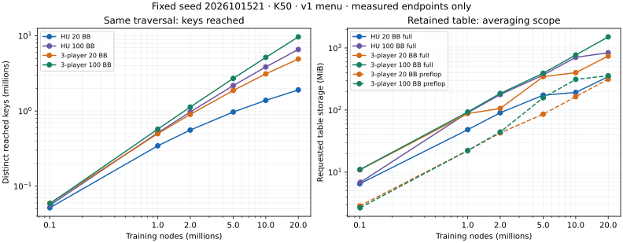

# Native three-player size measurement and bounded smoke

[PR291](https://github.com/dberweger2017/CFR-NLHE-6max/pull/291), October 15, 2026.
[Predeclared protocol](../nplayer-size-smoke-protocol.md). The owner cleared the
independent traversal/information/regret review of PR289 at `5df55c52`; both CI
shards passed before this dependent work. No merge is performed here.

## Size gate

All eight fixed configurations reach their 20M-node target without a capacity
or resource stop. Source/binary/input pins are in [admission](nplayer-size-smoke-artifacts/size-admission.json);
seed **2026101521**, exact actual nodes, street counts, capacities, payloads and
full curves are in [results](nplayer-size-smoke-artifacts/size-results.json).
Two 100k-node pilots, distinct seed 2026101520, admitted conservative per-run
quotes of 64/62 seconds against a 600-second cap. Each main job stays within
that cap; the entire size study has a 60-minute outer deadline.

A wrapper around the reviewed `State` interface counts every distinct decision
key reached by real training traversals, including opponent-only keys excluded
from average storage. It has no policy, RNG or update access. At N=2–6,
instrumented and plain training give identical tables, counters and checkpoint
bytes. Scope-0 and scope-3 main runs also produce identical reached-key and
visited-regret fingerprints at matching complete-iteration endpoints.

| Trainer / depth | Average scope | Reached keys | Retained entries | Retained requested MiB | Bytes/entry |
|---|---|---:|---:|---:|---:|
| Generic HU20 | all streets | 1,906,936 | 1,906,936 | 345.3 | 189.9 |
| Generic HU100 | all streets | 6,577,449 | 6,577,449 | 837.6 | 133.5 |
| Three-player 20 BB | all streets | 4,907,804 | 4,907,804 | 740.0 | 158.1 |
| Three-player 100 BB | all streets | 9,668,463 | 9,668,463 | 1,507.8 | 163.5 |
| Three-player 20 BB | preflop only | 4,907,804 | 2,209,039 | 314.5 | 149.3 |
| Three-player 100 BB | preflop only | 9,668,463 | 3,646,141 | 357.0 | 102.7 |
| Production HU20 K50 | all streets | — | 1,698,921 | 154.3 | 95.2 |
| Production HU100 K50 | all streets | — | 6,285,547 | 512.8 | 85.6 |

Production HU uses its unchanged compact store, key format and RNG; generic HU
uses the new key/traversal convention. These are two comparisons, not a claim
that player count alone explains every difference. The generic HashMap has
power-of-two capacity jumps, so bytes/entry varies with occupancy; HU20's
higher per-entry figure does not mean its entries intrinsically cost more.
Production-HU allocation figures also include retained scratch and worker
storage. Its checkpoint/save costs are in the results.

The meter counts requested allocations, not allocator metadata or OS residency.
Changes surviving a single-threaded generic step are attributed separately to
trainer storage and the observer. A deep-clone test independently verifies the
trainer attribution. Hash capacity plus actual regret/average arrays also
reconciles exactly. Process RSS snapshots and the on-host guard complement
these measurements. K50's fixed requested allocation is about 1.29 GiB; the
observer and checkpoint sorting are not silently charged to entry payloads.

Preflop-only averaging saves more than average arrays: postflop keys reached
only at sampled opponents no longer need a retained trainer entry. Such keys
are still counted by the survey and use the same uniform regret policy until
visited by their own traverser. At 20 BB the retained requested storage falls
**57.5%**; the regret strategy and reached-key set remain byte-identical.

## Projection and Phase 2 recommendation

[Projection inputs and calculations](nplayer-size-smoke-artifacts/projections.json)
include a local power fit, last-interval linear growth and origin-linear
scenarios. These are one-seed extrapolations, not statistical bounds or proof
of saturation. The last interval is 10M to 20M nodes. Do not use its power fit
alone to admit a much longer run.

Over the final measured interval, retained growth is **0.0857 keys/node**
for 20-BB preflop averaging and **0.1725 keys/node** at 100 BB. Full-street
three-player figures are 0.1792 and 0.4507. Local power exponents for the
preflop-scoped tables are 0.709 and 0.925 respectively; the deeper table is
still growing nearly linearly over this short interval.

The more conservative origin-linear scenario for three-player 20 BB with
preflop averages gives **22.1M /110.4M /552.2M retained entries** at
**200M /1B /5B nodes**. Planning peaks are **5.9 /21.4 /138.6 GiB** after adding
hash-growth overlap, 32 bytes per allocated vector for allocator overhead,
sorted checkpoint references and fixed inputs. Corresponding 100-BB preflop
scenarios are **10.1 /39.1 /165.9 GiB**. Full-street 100-BB averages project
**157.6 GiB at 1B**, already beyond this host. Actual RSS and new growth evidence
must govern admission; these scenarios do not guarantee a bound.

Recommend **three players, 20 BB, 50/100 blinds, the unchanged HU v1
minimum/pot/conditional-all-in menu, preflop-only averages, and 1B nodes** for
a first Phase 2 campaign. Use a **150M-entry capacity stop**, an **80-GiB family
RSS guard**, the existing <=8-CPU/85°C limits and checkpoints at 200M/500M/1B.
This leaves substantial room below the host's 125 GiB for allocation jumps,
recovery/export and the OS. Prefer a reported capacity stop to silently
freezing an unexamined key set. A 5B default is not justified by this study.
This recommendation authorizes no long campaign and makes no strength claim.

## Fixed smoke admission

The completed size gate admits the already requested **200M-node, three-player
20-BB** smoke: seed **2026101531**, **preflop-only averages**, a fixed
**30M-entry stop** (no freezing), pinned K50 and the same v1 menu. Run fresh to
200M, a separate 100M prefix, and resume that prefix to the identical 200M
endpoint. Compare complete compressed bytes. Node targets end at complete
iterations; no outcome-based extension is allowed.

The measured 20M traversal takes 18.98 seconds with census overhead. Scaling
its fresh+split work to 400M nodes quotes about 380 seconds of traversal;
allow approximately **20 minutes total** for growing tables, three saves,
recovery, export, loader/replay validation and hashing. The entire smoke batch
has a fixed **30-minute on-host deadline**, **32-GiB family RSS cap**, **48-GiB
free-disk floor**, <=8 assigned CPUs and an 85°C stop. Recheck host campaigns
before starting. A capacity/time/resource stop is reported, not retried or
extended. The 200M origin-linear estimate is about 22.1M entries /5.9 GiB
planning peak; the entry and host limits provide separate protection.

The committed runner `cdd8959a` fixed the play check before execution at
**128 hands**, seed **2026101532**, with three
separate policy instances, an exact repeated trace and independent pinned-engine
replay of every transition. It measures legal/reproducible play, not strength.

## Export and loader boundary

`nplayer-policy-v1` records N, full game/table identity, source checkpoint SHA256,
strategy mode, averaging scope and missing-key behavior. Exports are sorted,
atomic and deterministic. Both checkpoint and policy loads require the complete
expected SHA256. The loader validates metadata, sorted unique keys, owner/street,
action dimensions, finite normalized probabilities and row count.

`average` refuses a checkpoint without all-street averages. `scoped-average`
uses stored average probabilities through the chosen street and **current
regret-matching probabilities afterward**, named `current-after-average-scope`
in the header. Zero-mass and missing rows play uniform over the exact legal
menu. This is a minimal research continuation, not a full-street average or
search. The same export command also supports explicitly selected `current`.

Each seat owns its action RNG; identical models can share immutable weight
storage. Different matching-identity model files may be supplied per seat.
`Policy::choose` accepts only the acting seat's immutable observation and public
K50 tables. Decks, other holes, chance RNG and privileged replay records belong
to the harness, never the policy. The shared observation-to-key helper is a
mechanical extraction from the reviewed cash adapter. At both 20/100 BB and
scope 0/3, complete 100k-node checkpoints match the reviewed PR289 binary exactly.

Rust fixtures cover N=2–6, strategy scope, deterministic export and malformed
metadata/rows/probabilities. Real-K50 tests compare every exported probability
with its source accumulator, reject an unavailable full average, and check
three-instance repeatability plus independent engine parity. A streaming Python
audit separately recalculates every exported probability; a deliberately wrong
probability row proves it rejects corrupted output.

## Smoke result

The complete fixed batch passes in **908.81 seconds (15.15 minutes)** under
its 1,800-second watchdog. Fresh and resumed runs end at **200,000,154 nodes**,
**359,261 complete iterations** and **8,246,876 entries**, with no freezing,
discarded updates or capacity/time stop. Their complete **335,278,630-byte**
checkpoints are identical:

`2bfe844a2bba1161b354bc5d7af721221786a23a57d775447cf8ede2fcc33b4a`

The independent prefix ends at 100,000,619 nodes /5,846,944 entries.
[Recovery](nplayer-size-smoke-artifacts/smoke--recovery.json),
[fixed admission](nplayer-size-smoke-artifacts/smoke--admission.json),
[operations and exact commands](nplayer-size-smoke-artifacts/smoke--operations.json).

| Operation | Process wall seconds | Traversal Mnodes/s | Sampled family peak GiB |
|---|---:|---:|---:|
| Fresh 200M | 304.91 | 1.059 | 2.756 |
| Fresh 100M prefix | 172.26 | 1.108 | 2.127 |
| Resume 100M to 200M | 244.37 | 1.007 | 2.817 |
| Scoped export | 96.06 | — | 1.565 |
| First / repeated 128-hand play | 14.65 /14.80 | — | 1.189 /1.190 |

Traversal rates use the last periodic telemetry point, excluding startup,
checkpoint load/save and final hashing; the resumed rate subtracts prefix nodes.
Process wall time includes those costs. Generic traversal is single-threaded;
this is not an eight-thread scaling benchmark. Save/load costs are material:
the fresh traversal reaches its last periodic point in 188.91 seconds, while
the complete fresh process takes 304.91 seconds.
[Full measurements](nplayer-size-smoke-artifacts/smoke-statistics.json).

The guard's final maximum is **68°C**, with **2.817 GiB sampled family RSS**,
zero swap growth and no thermal-throttle counter increase. Minimum available
RAM is 120.50 GiB and free disk 386.01 GiB. CPU affinity is 0–7; explicit child
settings cap Rayon at four and BLAS/MKL at two threads. Two-second RSS samples
can miss brief allocation peaks, especially in the small pilots; they are
observations, not hard measured maxima between samples. The on-host resource
limits remain independent of the allocation model.
[All guard receipts](nplayer-size-smoke-artifacts/guards.json).

The terminal has fewer entries than the 22.1M origin-linear scenario and its
observed RSS is below the 5.9-GiB planning scenario. This is a useful check at
200M on a different fixed seed, not evidence to enlarge the Phase 2 budget or
treat the projection as a guaranteed bound.

The **scoped-average export** has SHA256
`fcbe8bd5733572fe9f9046840d6e277a0b11ce0ac96936546df0815be218485e`.
The independent streaming audit checks **all 8,246,876 rows** in 54.20 seconds:
444,827 preflop-average rows, 7,802,049 current-policy continuation rows and
146,453 zero-mass uniform rows. No audit mismatch.
[Audit](nplayer-size-smoke-artifacts/smoke--export-audit.json).

Both 128-hand plays use three separate action RNG/policy instances sharing one
immutable weight table. All **778 decisions** per play match the pinned pokers
engine's actions, states, public history and settlement. Seats make 254/280/244
decisions; one turn decision misses its key and uses the declared uniform
fallback. The complete privileged traces are byte-identical, SHA256
`f167f100e90ba2f43bdf0d1b22f3c31bfb199bf8e0b53e2f958909cfa4f668f1`.
[First oracle check](nplayer-size-smoke-artifacts/smoke--play-0-oracle.json),
[repeat](nplayer-size-smoke-artifacts/smoke--play-1-oracle.json),
[final result](nplayer-size-smoke-artifacts/smoke--result.json).
These few self-play hands establish the pipeline, not NLHE strength or general
coverage. Multiway abstraction, search and a full later-street average remain
separate work.

## Regression validation and limits

The final native tree is `a77c1acbbc7a64c4c1a2f10b70094e6b7781539d`, built from
`cdd8959a`; later edits add only documentation, receipts and the plotting helper.
The remapped HU executable SHA256 is
`3ecffc564294fe31774ce74e64dc50fac862704e5402f65834c2215f6c30c9a1`.
It differs from the reviewed parent's executable, so output identities were
re-executed rather than inferred from unchanged HU source files.

- **43 Rust tests** pass: 37 library, five CLI and one allocation/sampler control.
- **362 Python tests** pass with the real K50 tables and strict MKL, including
  the native suite, export/loader/replay checks and existing compact-policy/audit
  regressions. The independent every-row audit rejects its wrong-probability
  control. [Test receipts](nplayer-size-smoke-artifacts/tests.json).
- Four N-player cash configurations (20/100 BB × scope 0/3) reproduce the
  reviewed PR289 complete checkpoint bytes after the observation-key helper
  extraction. [Compatibility](nplayer-size-smoke-artifacts/key-compat--receipt.json).
- All **18** HU20/HU100/HU200 × v1/v2 checkpoint/current/average identities
  match the qualified baseline. HU100 fresh and resumed capacity terminals
  retain `792a675ce6d45d4de8d1b7f3fc6d976548610810f11da8f336c3926f37f8d416`.
  [HU identities](nplayer-size-smoke-artifacts/hu-identities--receipt.json).
- #250 fresh 20M and 10M-to-20M resume both retain
  `4009bbbce8d95a722e4e63e96dfc6e2b67957095f06c53487a29e4bf3d3acc8b`.
  [Pinned recovery](nplayer-size-smoke-artifacts/gate-results--checkpoints.json).
- The fixed HU20 v0.4.1 1B identity finishes in **784.18 seconds** under its
  900-second guard. Its 142,677,367-byte average retains
  `571e198266eabc6d8bb9de2d1aa76d9a68be0b2512222ea96874168989c6b74d`.
  [Release identity](nplayer-size-smoke-artifacts/hu20-release-identity--result.json).

All 20 guarded jobs pass; none is automatically extended. The implementation
and smoke-receipt revision `734a950b` also passes all five GitHub checks,
including both full CI shards. [CI snapshot](nplayer-size-smoke-artifacts/ci-implementation.json).
Final receipt/prose edits leave the tested native tree unchanged. The final PR
head must still pass its own checks before the owner merges it.

This completes the requested Phase 1 implementation and evidence, following
reviewed million-hand rule parity and the reviewed known-game traversal gate.
The initial failed Leduc study remains recorded beside its separately approved
passing confirmation. This is not a general multiplayer equilibrium guarantee
or an NLHE strength claim. PR289 remains owner-merge pending; PR291 awaits its
own review/merge. No release, search or longer N-player campaign is started.
The Phase 2 configuration above is a recommendation only.

All raw data, generated policies/checkpoints and failure/setup evidence remain
protected in the indexed bb128 root and its dependencies. Cloud archival and
cleanup are pending; no originals were removed and no M4 compute was used.
[Storage and retrieval](../../RESULTS_INDEX.md).
