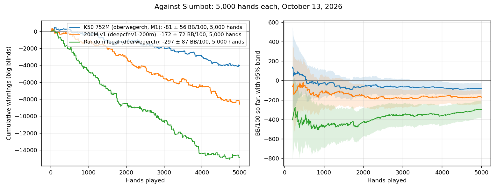

# Slumbot: K50 752M, 200M and a random floor, 5,000 hands each

Three players against Slumbot's live API on October 13, 2026, 5,000 verified hands each:

| Player | Account | BB/100 [95%] | All-in adjusted |
|---|---|---:|---:|
| **K50 752M** (#250) | `dberwegerch` (the M1, [#261](hu200-k50-752m-slumbot-benchmark.md)) | **−81 ± 56** | −74 ± 51 |
| **200M v1** (#248) | `deepcfr-v1-200m` | **−172 ± 72** | −178 ± 65 |
| **Random legal** (#253's floor) | `dberwegerch` | **−297 ± 87** | −301 ± 70 |



The order is the expected one: random below the 200M model, the 200M model below K50 752M. Differences between independent runs:

| Difference | BB/100 | 95% | Corrected for three comparisons |
|---|---:|---|---|
| K50 752M − 200M | +91 | [+0.3, +182] | [−20, +202] |
| 200M − Random | +125 | [+13, +238] | [−12, +263] |
| K50 752M − Random | +217 | [+113, +320] | [+90, +343] |

Each difference alone clears zero; with the correction for three comparisons, only K50 752M against random does. The two models differ in card abstraction (K50 against v1) and in training (752M against 200M nodes), so the gap between them belongs to both changes together.

## The runs

| | K50 752M | 200M v1 | Random legal |
|---|---|---|---|
| Model SHA256 | `60bd37c9…` with #163's tables | `b7c15eb6…` | — |
| Machine | the M1 (three parts, #261) | the Linux server | the Linux server |
| Policy seed | 2026101305–07 | 2026101310 | 2026101311 |
| Requests; median latency | about 17,000; 0.36 s in part 3 | 16,169; 0.29 s | 12,859; 0.30 s |
| Abandoned hands | 13 (parts 1 and 2) | 0 | 0 |

The random player picks a uniform legal action, never folds when it could check, and raises to a uniform size between the min-raise and all-in (`play_slumbot --player random`). Every settlement was recomputed from the public actions and both revealed hands and equals Slumbot's reported winnings. Every journal's hash chain verifies. Slumbot's session totals equal our verified nets in every run. The 200M and random runs used `--account`, which refuses any other username; the earlier 200M run (#253, 1,796 hands on `dberwegerch`, −103 ± 110) is not pooled here.

## Where the chips went

Chips per 100 hands by how hands ended:

| How hands ended | K50 752M | 200M v1 | Random |
|---|---:|---:|---:|
| We folded preflop | −28.4 | −42.8 | −140.5 |
| Slumbot folded preflop | +21.8 | +24.3 | +55.9 |
| Showdown | **−49.8** | **−150.2** | −104.9 |
| Slumbot folded, flop to river | +138.4 | +146.4 | +81.7 |
| We folded, flop to river | **−106.9** | −97.8 | −125.6 |
| All-in before the river | −56.0 | −52.0 | −64.0 |
| **Total** | **−80.8** | **−172.1** | **−297.4** |

Most of the gap between the models is at showdown: K50 752M loses 2.8 BB per showdown, the 200M model 10.8. Their postflop folding costs about the same, and it is K50's largest loss.

**Folding to half-pot bets.** 82% of Slumbot's opening flop bets against K50 752M were exactly half the pot. Both models fold to them about half the time, as often as to pot-sized bets:

| Facing Slumbot's bet | Flop | Turn | River |
|---|---:|---:|---:|
| Half pot, K50 752M | 50% of 604 | 47% of 409 | 50% of 246 |
| Half pot, 200M | 52% of 448 | 44% of 296 | 51% of 153 |
| Pot, K50 752M | 59% of 70 | 49% of 70 | 36% of 50 |

A half-pot bet is profitable as a pure bluff when we fold more than a third of the time. The v1 history labels in both models give every raise between 0.5× and 1.5× the pot the same label (`src/blueprint/abstraction.py`, `_history`), and their menus bet only the minimum, the pot or all-in, so in training that label mostly meant a pot-sized bet. The model may therefore answer half-pot bets as if they were pot bets. That is a hypothesis to test against a scripted half-pot bettor; it is not established here.

**Stored policy coverage:** uniform fallback on 0.9–6.4% of K50 752M's decisions (preflop to river) and 1.0–8.4% of the 200M model's.

## Still running

The dedicated account `deepcfr-k50-752m` is playing up to 200,000 hands of K50 752M from the Linux server (−69 ± 36 BB/100 over its first 13,596 hands). It will be reported separately.

## Reproduce

```
python -m scripts.analyze_slumbot_run RUN [RUN ...] [--out ANALYSIS.json] [--model AVERAGE.gz --model-sha256 SHA ...]
python -m scripts.plot_slumbot_runs --player "LABEL=RUN[,RUN...]" ... --out CHART.png
```

Journals, summaries and analyses are archived as indexed in RESULTS_INDEX.md.
