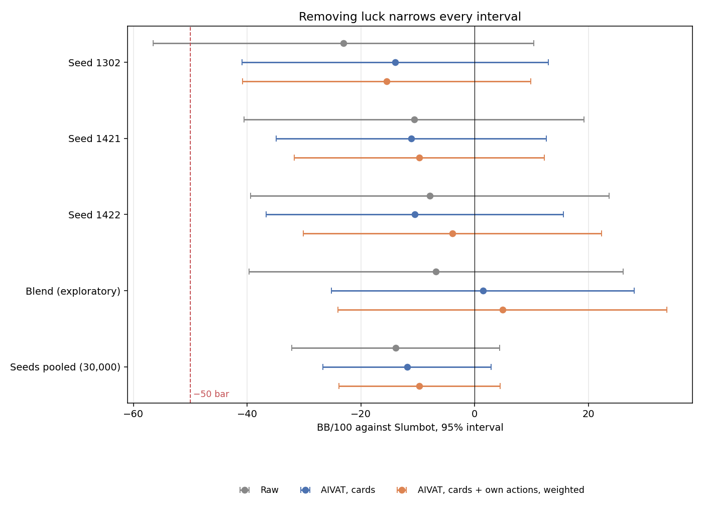
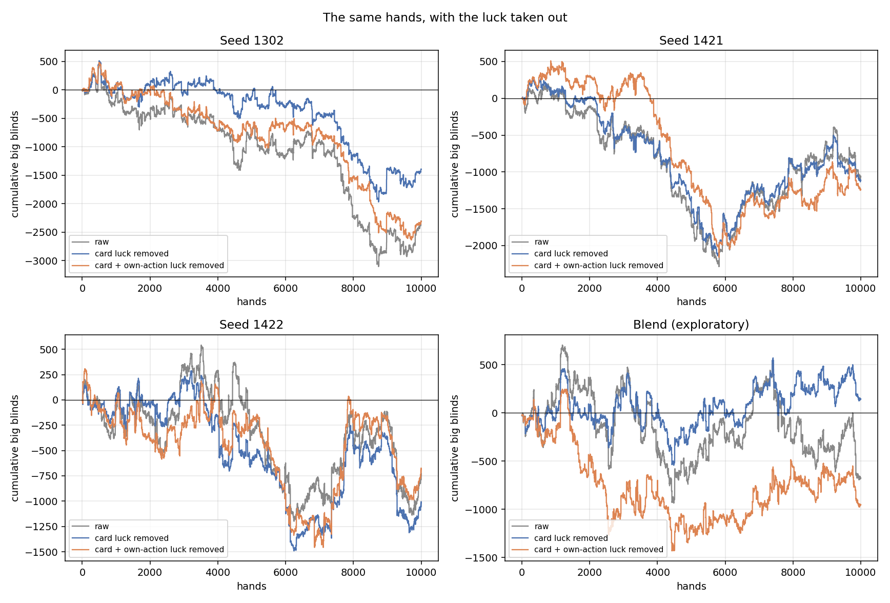
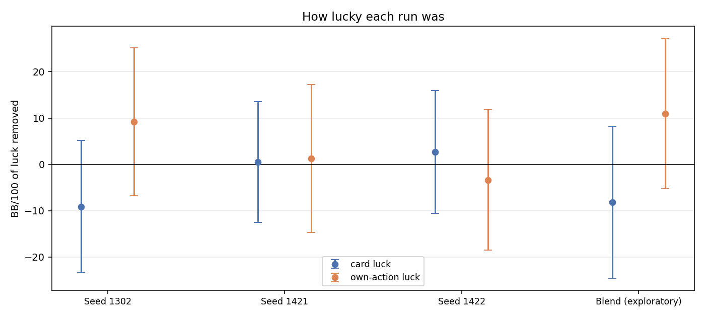
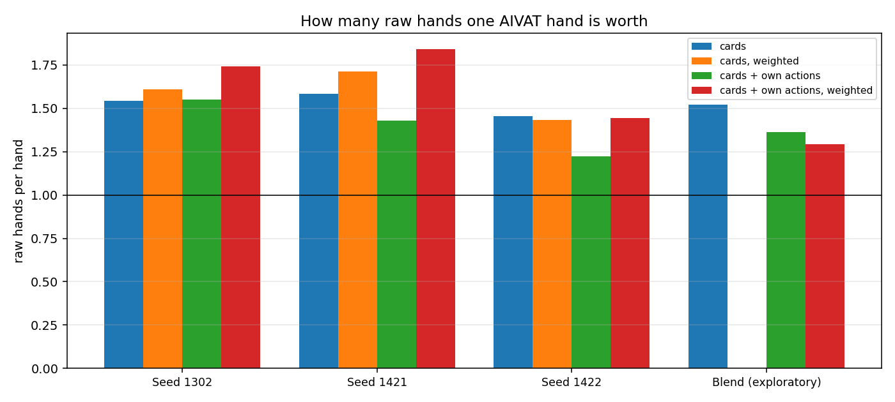
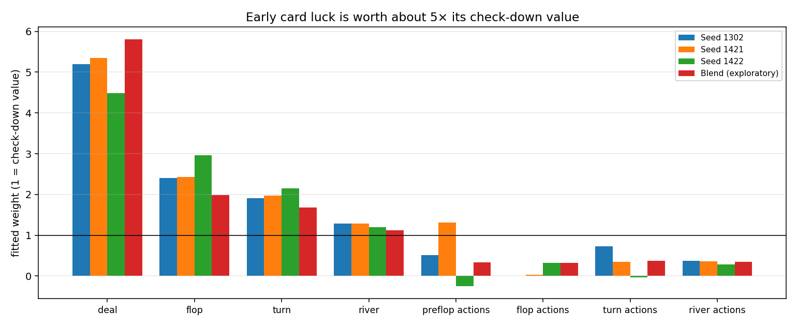
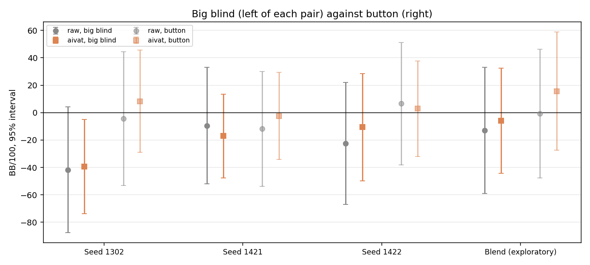

# AIVAT on real Slumbot hands

[#314](https://github.com/dberweger2017/CFR-NLHE-6max/pull/314), contributed by @mstampfli, added AIVAT luck removal to `scripts.analyze_slumbot_run`. Its author had no Slumbot journals. This report runs the merged code on all our completed 10,000-hand Slumbot runs since then:

- #304's three v0.5.5 confirmation runs (seeds 2026101302, 2026101421, 2026101422);
- the v0.5.5 three-seed blend's exploratory run on account `deepcfr-v055-bx` (#306's audited model, SHA256 `ce3ecc2c…e6485`).

**In short:**

- **AIVAT works on our real data and is unbiased.** Over 40,000 hands, the removed card luck and own-action luck both average zero within noise.
- **One AIVAT hand is worth 1.3–1.8 raw hands.** The pooled seeds' interval narrows from ±18.3 to ±14.2 BB/100.
- **What limits it is the value estimate, not the method.** Early card luck is worth about 5× what the check-down estimate assigns it, and the own-action corrections add nearly as much noise as they remove.
- **#304's failure was mostly card luck.** Seed 2026101302 had −9 BB/100 of it; luck removed, it sits at −15.5 [−40.8, +9.9], like the other seeds. With AIVAT as the declared statistic, #304's rule would have passed a recipe of this strength about twice as often.
- **The blend looks a little better than the seeds against Slumbot** (+4.9 against −9.7 BB/100 luck removed), but the difference is within noise, matching #306's +2 BB/100 internal result.

Nothing here changes a verdict. #304's rule was raw BB/100, declared in advance, and using AIVAT in any acceptance rule needs a protocol declared before the hands it judges.



## What was run

- **Hands:** each run's first 10,000 completed hands, parts pooled in play order. #304's runs come from the [archive](../../RESULTS_INDEX.md) `hu200-v055-slumbot-confirmation-20261015.zip`. The blend run's first part was cut by a power loss after 8,300 verified hands; its verified prefix and a 1,700-hand second part (next policy seed) make up its 10,000.
- **Code:** the merged #314 code (`515e0595`), run unchanged. A small [wrapper](slumbot-aivat-real-runs/dump_aivat.py) also saves each hand's corrections for the charts. Its summaries are identical to the analyzer's: all three seeds reproduce their earlier summaries exactly.
- **Modes:**
  - **cards only:** `--aivat`;
  - **cards + own actions:** `--aivat --model …`, with each run's own model, read-only policy cache, K50 tables and translation 512/128.
- **Prerequisite, checked on real data:** Slumbot reveals its hole cards on every hand, folds included (9,729 of 9,729 hands checked in one run). So every hand gets card corrections, with no selection.
- **Cost:** about 1.5 CPU seconds per hand. The work ran on cygnus-x1 (under a heat guard that stopped one run at VRM 88 °C; it was redone elsewhere with identical code) and on our Slumbot server.

## Results

BB/100 with 95% intervals over 10,000 hands. "Worth" is the raw variance divided by the estimate's variance: how many raw hands one hand is worth.

| Run | Raw | AIVAT, cards | AIVAT, cards + own actions, weighted | Worth (cards / best) |
|---|---|---|---|---:|
| Seed 2026101302 | −23.07 [−56.53, +10.38] | −13.95 [−40.89, +12.99] | −15.49 [−40.82, +9.85] | 1.54 / 1.74 |
| Seed 2026101421 | −10.66 [−40.53, +19.21] | −11.15 [−34.88, +12.59] | −9.74 [−31.75, +12.27] | 1.58 / 1.84 |
| Seed 2026101422 | −7.87 [−39.39, +23.65] | −10.53 [−36.66, +15.59] | −3.89 [−30.10, +22.33] | 1.46 / 1.45 |
| **Seeds pooled, 30,000** | −13.87 [−32.14, +4.40] | −11.88 [−26.68, +2.93] | **−9.70 [−23.90, +4.49]** | |
| **Blend, exploratory** | −6.79 [−39.65, +26.08] | +1.45 [−25.21, +28.10] | **+4.89 [−24.01, +33.79]** | 1.52 / 1.29 |

All four modes for every run (plain and weighted, cards and cards + own actions), by seat and with the fitted weights, are in the receipts in [`slumbot-aivat-real-runs/`](slumbot-aivat-real-runs/).



*Cumulative big blinds over each run: raw (grey), card luck removed (blue), card and own-action luck removed (orange, plain estimate). The gap between the lines is the luck.*

## Is it unbiased? The zero-mean check

AIVAT only subtracts outcomes drawn from known odds (cards, or our own sampled actions) minus their exact average, so the removed luck must average zero. On real data:

| Removed luck, BB/100 | Seed 1302 | Seed 1421 | Seed 1422 | Blend | All four pooled |
|---|---|---|---|---|---|
| Cards | −9.13 ± 14.26 | +0.49 ± 13.05 | +2.66 ± 13.25 | −8.23 ± 16.39 | **−3.55 ± 7.15** |
| Own actions | +9.20 ± 16.00 | +1.25 ± 15.95 | −3.39 ± 15.15 | +10.97 ± 16.24 | **+4.51 ± 7.91** |

Both pooled terms are within noise of zero (|z| ≈ 1), so there is no sign of bias. Card and own-action corrections are nearly independent within hands (correlation 0.03–0.09). The opposite signs in seed 2026101302 and the blend are chance, not one correction undoing the other.



## How much it helps, and what limits it



- **Card corrections alone are consistently worth about 1.5 raw hands** (1.46–1.58 on all four runs).
- **Adding own-action corrections helps little in the plain estimate.** The action corrections spread about as widely as the card corrections (standard deviation about 800 against about 700 chips per hand), but they track the result much less (correlation with raw winnings 0.12–0.28, against about 0.6 for cards). So they add almost as much noise as they remove.
- **The weighting partly fixes that:** it shrinks the action corrections to about 0.3. The weighted cards + own actions estimate is the best on two runs (1.74 and 1.84); on seed 2026101422 and the blend, cards alone does as well or better (1.46 and 1.52).



**The fitted weights point at the value estimate.**
- **Cards:** the deal's correction gets a weight of about 4.5–5.8 and the flop's about 2–3, consistent across all four runs. The check-down value (pot × equity) prices early luck at the small pot of the moment, while early cards steer much larger later pots.
- **Actions:** the weights near 0.3 say the action values ("a raise valued as if called") are too crude to remove much luck.

**A value estimate that anticipates later betting** is the clear next step. The model's own action values, or a short rollout, would turn both kinds of luck into larger removals. Published AIVAT results remove far more variance than the 1.3–1.8× here, and #314's structure keeps that a contained change.

## What it says about v0.5.5's failure

#304 failed because seed 2026101302's raw lower bound was −56.53, below the −50 bar, while the other two passed. AIVAT now measures what #304 could only infer:

- **Seed 2026101302 had −9.13 BB/100 of card luck.** With it removed, the seed sits at −13.95 [−40.89, +12.99]; with all measured luck removed (weighted), at −15.49 [−40.82, +9.85]. That's in line with the other seeds, and with lower bounds well above −50.
- **The three seeds are consistent with one recipe:** pooled −9.70 [−23.90, +4.49], luck removed.

**The rule's real problem was its pass chance.** At 10,000 hands per seed, each seed had to measure above about −18. With AIVAT's weighted estimate (about 1.65× the information per hand, interval about ±24.6), the threshold would have been about −25:

| True rate | Raw: one seed / all three pass | AIVAT, weighted: one seed / all three pass |
|---:|---:|---:|
| −20 | 46% / 10% | 67% / 30% |
| −14 | 61% / 22% | 82% / 55% |
| −10 | 70% / 34% | 89% / 70% |
| −5 | 80% / 51% | 95% / 85% |
| 0 | 87% / 66% | 98% / 94% |

For a recipe at about −10, AIVAT would have roughly doubled the chance of passing (34% → 70%) with the same hands. This is hindsight, so it doesn't change #304's verdict. But it is the strongest argument for declaring AIVAT as the decision statistic in future Slumbot protocols, once its value estimate is improved. The current [version 2 protocol](../hu200-v055-acceptance-protocol-v2.md) stays raw, as declared.

## The blend against the seeds

- **Luck removed (weighted), the blend's exploratory run is at +4.89 [−24.01, +33.79],** against −9.70 [−23.90, +4.49] for the three seeds pooled. The difference, +14.6 [−17.6, +46.8], is within noise.
- **#306's precise internal comparison found the blend only about +2 BB/100 stronger than its seeds,** so most of this gap is likely noise too.
- **The blend run also had −8.23 of card luck,** like seed 2026101302. With cards only removed it moves from −6.79 to +1.45.

## By seat



**Luck removed (weighted), the big blind trails the button in all four runs:**

| Run | Big blind | Button |
|---|---|---|
| Seed 2026101302 | −39.3 | +8.4 |
| Seed 2026101421 | −17.1 | −2.4 |
| Seed 2026101422 | −10.7 | +2.9 |
| Blend | −5.9 | +15.7 |

Each gap is within its own noise, but the direction is consistent. Big-blind defense against Slumbot's button play is worth a closer look.

## Next steps

1. **A better value estimate for AIVAT,** using the model's own action values, ideally contributed through #314's framework. It should multiply the information per hand well beyond 1.5–1.8×.
2. **Then a future Slumbot protocol could declare AIVAT** as its statistic, with pass chances computed from the measured worth.
3. **Big-blind play** as a targeted diagnosis.

## Reproduce

```sh
# per run: the analyzer's summary plus per-hand corrections
AIVAT_DUMP=perhand.jsonl PYTHONPATH=. python docs/reports/slumbot-aivat-real-runs/dump_aivat.py \
  PART1_DIR PART2_DIR --hands 10000 --aivat --workers 4 \
  --model MODEL --model-sha256 SHA --card-buckets TABLES --policy-cache CACHE --cache-read-only \
  --action-translation --translation-max-states 512 --translation-max-events 128 --out summary.json
# charts
python -m scripts.plot_slumbot_aivat --run "LABEL=perhand.jsonl,summary.json" [...] \
  --pool "Seeds pooled=LABEL1,LABEL2,LABEL3" --out-dir charts
```

The per-hand files (four × about 1.9 MB) are archived with the journals; see [RESULTS_INDEX](../../RESULTS_INDEX.md). The analyzer's summaries are in [`slumbot-aivat-real-runs/`](slumbot-aivat-real-runs/).
