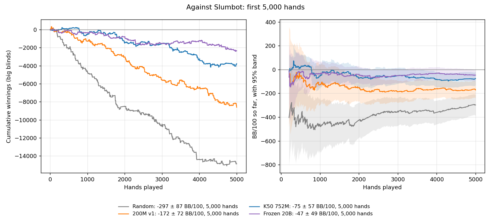
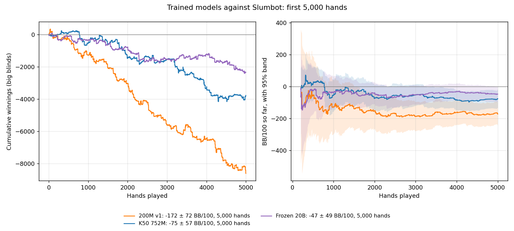
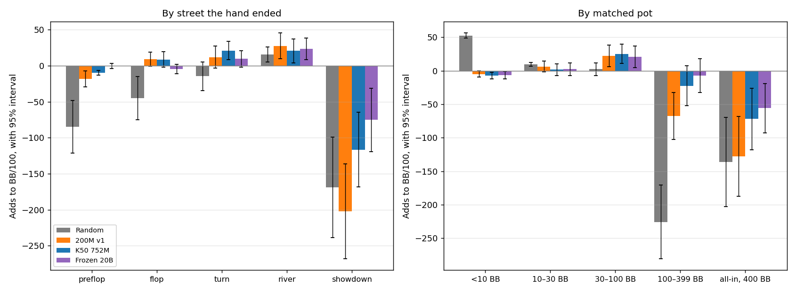

# Slumbot: frozen 20B against earlier models, 5,000 hands each

Four players against Slumbot's live API at 200 BB, on equal hands: the first
5,000 of every run.

| Player | BB/100 [95%] | All-in adjusted |
|---|---:|---:|
| **Frozen 20B** (#265) | **−47 ± 49** | −52 ± 48 |
| **K50 752M** (#250) | **−75 ± 57** | −81 ± 51 |
| **200M v1** (#248) | **−172 ± 72** | −178 ± 65 |
| **Random legal** (#253's floor) | **−297 ± 87** | −301 ± 70 |

Each step of training improved the result: the 200M v1 model over random play,
K50 cards and 752M nodes over 200M, and 20B frozen-table nodes over 752M. Both
K50 models were trained on a base M4 MacBook Pro with 16 GB, peaking at 8.8 GiB.

## Training cost, for context

Slumbot won the 2018 Annual Computer Poker Competition's heads-up no-limit event.

| | Slumbot | Frozen 20B |
|---|---|---|
| Machine | Several commodity machines: its 2013 design keeps regrets on disk and distributes the solve ([Jackson, 2013](https://cdn.aaai.org/ocs/ws/ws0979/7044-30516-1-PB.pdf)) | One MacBook Pro, base M4 chip, 16 GB |
| Memory | About 2 TB, as reported | Peak 8.8 GiB |
| Compute | About 250,000 core-hours, as reported | About 7 core-hours: two cores for 15 minutes to 752M nodes ([#250](hu200-k50-first.md)), then 3 hours 7 minutes to 20B ([#265](hu200-k50-frozen.md)) |
| Strategy | A large abstraction with many bet sizes | 85.4M stored keys; bets the minimum, the pot or all-in; 3.16 GB average |

Slumbot's memory and compute figures come from secondary sources, [GTO
Wizard's blog](https://blog.gtowizard.com/crushing-a-top-hunl-poker-bot/) and a
[CMU lecture](http://www.cs.cmu.edu/~sandholm/cs15-888F21/lecture14.pdf), not
from Jackson's paper. Our K50 card tables were built once on a rented machine,
in 40 minutes at about $0.15, with a 10.3 GiB peak ([#163](hu20-equity-buckets.md)).

This compares cost, not strength. Slumbot's abstraction is built to be hard to
exploit by any opponent; frozen 20B has known holes, losing heavily to a scripted
1.5× pot bettor ([#271](hu200-k50-translation.md)). Against Slumbot itself it
loses about half a big blind per hand, −47 ± 49 BB/100 over these 5,000 hands.





## Differences

Over the first 5,000 hands of independent runs:

| Difference | BB/100 | 95% | Corrected for six comparisons |
|---|---:|---|---|
| Frozen 20B − K50 752M | +29 | [−46, +103] | [−72, +129] |
| K50 752M − 200M | +97 | [+5, +188] | [−27, +220] |
| 200M − Random | +125 | [+13, +238] | [−26, +277] |
| Frozen 20B − 200M | +125 | [+39, +212] | [+9, +241] |
| Frozen 20B − Random | +250 | [+151, +350] | [+117, +384] |
| K50 752M − Random | +222 | [+118, +326] | [+82, +362] |

Each step to the next model is positive; the one from K50 752M to frozen 20B
isn't separable from zero at this size. With the correction, frozen 20B is
better than the 200M model and both K50 models better than random. Internally,
frozen 20B beats K50 752M by +76.95 [71.93, 81.96] BB/100 in a direct match
([#268](hu200-frozen-evaluation.md)).

## Where the chips went

What each kind of hand adds to the overall BB/100, over the first 5,000 hands,
with 95% intervals. The groups add up to the total.



| Hand ended | Random | 200M v1 | K50 752M | Frozen 20B |
|---|---:|---:|---:|---:|
| Preflop | 70%, −85 ± 36 | 52%, −18 ± 11 | 46%, −10 ± 3 | 34%, −0 ± 4 |
| Flop | 17%, −45 ± 30 | 17%, +9 ± 10 | 18%, +9 ± 11 | 22%, −5 ± 6 |
| Turn | 6%, −15 ± 20 | 10%, +12 ± 15 | 11%, +21 ± 13 | 14%, +10 ± 11 |
| River | 3%, +16 ± 10 | 7%, +28 ± 18 | 8%, +21 ± 17 | 11%, +23 ± 15 |
| Showdown | 4%, −169 ± 70 | 14%, −202 ± 66 | 18%, −116 ± 52 | 20%, −75 ± 44 |

Each cell: share of hands, then what those hands add.

- **Showdowns are where every model loses.** All other hands together are
  about break-even or better for the trained models; showdowns cost 200M 202
  BB/100, K50 752M 116 and frozen 20B 75.
- **The preflop leak is gone.** Frozen 20B folds its small blind 11% of the
  time against 24% for K50 752M and 38% for 200M, and hands it ends preflop add
  −0 ± 4 instead of −10 ± 3 and −18 ± 11.
- **Big pots still cost the most.** Pots of 100 BB or more (matched by both
  sides) are 2–3% of hands and cost frozen 20B about 63 BB/100, K50 752M 94 and
  200M 196.

## How they played

Each cell: the player / Slumbot against that player, over the first 5,000 hands.

| Statistic | Random | 200M v1 | K50 752M | Frozen 20B |
|---|---:|---:|---:|---:|
| Voluntarily put chips in preflop | 63% / 53% | 59% / 65% | 68% / 70% | 81% / 75% |
| Raised preflop | 34% / 53% | 35% / 54% | 37% / 56% | 43% / 57% |
| Small blind: fold · limp · raise | 33·34·33% / 11·0·89% | 38·26·36% / 11·0·89% | 24·30·46% / 10·0·90% | 11·26·64% / 10·0·90% |
| 3-bet | 33% / 6% | 33% / 21% | 27% / 19% | 22% / 19% |
| Flop c-bet | 57% / 59% | 61% / 60% | 55% / 55% | 64% / 56% |
| Fold to a flop c-bet | 37% / 76% | 48% / 34% | 56% / 35% | 56% / 33% |
| Saw the flop | 30% | 48% | 54% | 66% |
| Won at showdown | 37% | 40% | 45% | 48% |
| Bet or raised, flop · turn · river | 46·44·41% / 21·28·29% | 53·51·50% / 20·23·29% | 46·44·40% / 21·26·30% | 34·36·38% / 26·25·30% |

A 3-bet is any re-raise of the first preflop raise, including after a limp; a
c-bet is the last preflop raiser betting first on the flop.

Frozen 20B plays more hands than K50 752M, raises more preflop, and is less
aggressive after the flop. Slumbot never limps from the small blind and opens
about 90% of the time against every player.

**Bet sizes.** Share of postflop bets and raises by size, as a fraction of the
pot after calling:

| Side | Under 0.4 | About ½ | ⅔–¾ | About pot | 1.2–2.5× | Over 2.5× | All-in |
|---|---:|---:|---:|---:|---:|---:|---:|
| 200M v1 | 55% | 5% | 0% | 38% | 0% | 0% | 1% |
| K50 752M | 55% | 6% | 0% | 38% | 0% | 0% | 1% |
| Frozen 20B | 49% | 6% | 0% | 44% | 0% | 0% | 1% |
| Slumbot against the three models | 3–9% | 61–73% | 4–8% | 14–16% | 2–6% | 0% | 1–3% |

The models' menu bets the minimum, the pot or all-in, and about half their
postflop bets are minimum bets; the ~6% near half the pot are almost all 1 BB
minimum bets into 2 BB pots (193 of frozen 20B's 195). Slumbot bets about half
the pot most of the time.

**Answers to Slumbot's half-pot bets** (fold · call · raise):

| Street | 200M v1 | K50 752M | Frozen 20B |
|---|---:|---:|---:|
| Flop | 52·24·25% of 448 | 53·30·17% of 558 | 54·36·10% of 977 |
| Turn | 43·27·30% of 298 | 39·37·24% of 415 | 52·39·9% of 448 |
| River | 50·25·25% of 161 | 46·37·17% of 246 | 55·32·13% of 310 |

A half-pot bet profits as a pure bluff when it gets a fold more than a third
of the time; every model folds to it about half the time. Frozen 20B raises it
much less often and calls more, but folds as often on the flop and more on the
turn and river than K50 752M.

**Hand length:** 3.1 actions per hand for random, 4.5 for 200M, 4.9 for K50
752M and 5.6 for frozen 20B, which reaches the flop most often.

## The runs

| | Frozen 20B | K50 752M |
|---|---|---|
| Model SHA256 | `9128f71c…` (#265, 20,000,002,032 nodes) | `60bd37c9…` (#250, 752,593,175 nodes) |
| Cards | #163's K50 tables | #163's K50 tables |
| Machine | the Linux server | the Linux server |
| Policy seeds | 20261014026801, 20261014026802 | 2026101308, 2026101309 |
| Parts | 490 hands, then the rest (relaunched with a larger hand target) | 588 hands, then the rest (relaunched with the policy cache) |
| Abandoned hands in the counted hands | 46 (45 unanswered requests, 1 refused), 0.9% | 0 |

The 200M and random runs are [#264's](slumbot-account-benchmarks.md). Every
journal's hash chain verifies, every settlement recomputes from the public
actions and both revealed hands, and Slumbot's session totals equal the
verified nets in every session: abandoned hands, which Slumbot also counts,
cost nothing. Frozen 20B's run continues past these hands; nothing after the
counted hands was used.

Frozen 20B with #271's action translation is reported separately.

## Reproduce

```
python -m scripts.analyze_slumbot_run RUN [RUN ...] --hands N --out ANALYSIS.json
python -m scripts.plot_slumbot_runs --hands N --player "LABEL=RUN[,RUN...]" ... [--color LABEL=COLOR ...] --out CHART.png
python -m scripts.profile_slumbot_runs --hands N --player "LABEL=RUN[,RUN...]" ... --out PROFILE.json --markdown PROFILE.md --chart CHART.png
```

`--hands N` keeps each player's first N hands in play order. The profile works
from the public action strings alone (`src/arena/external/style.py`), so it
covers players without decision records. Journals, analyses and profiles are
archived as indexed in RESULTS_INDEX.md.
