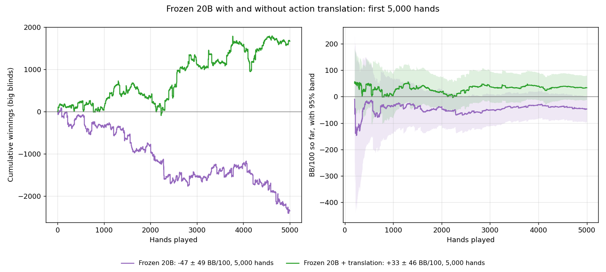
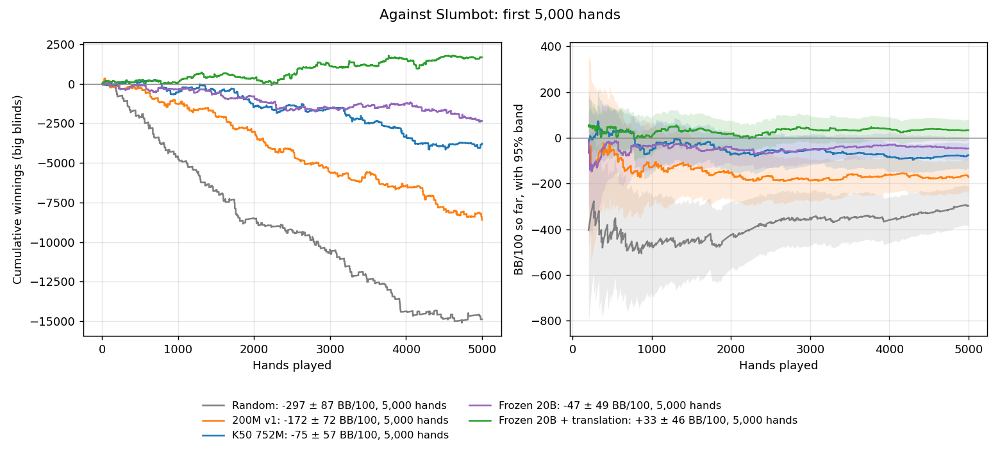
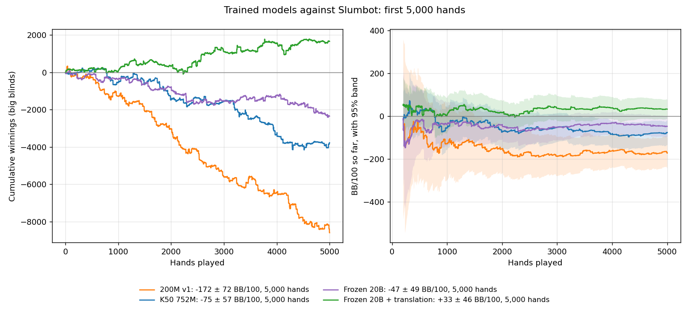
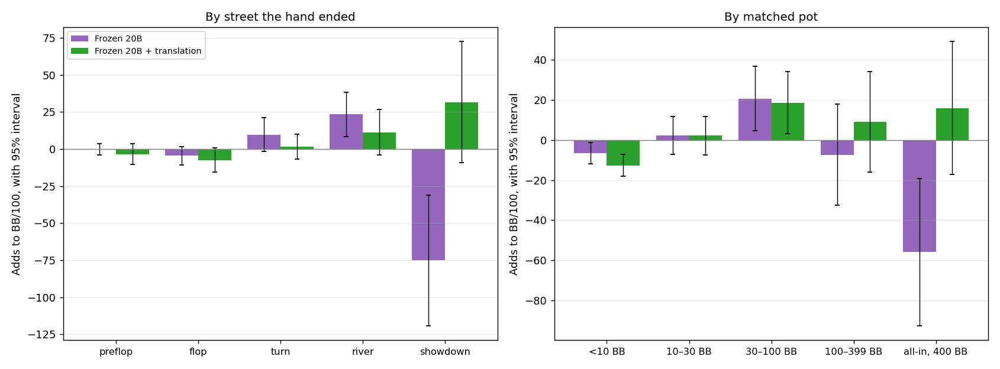

# Slumbot: frozen 20B with and without action translation, 5,000 hands each

The same model, #265's 20B frozen-table average, played Slumbot's live API at
200 BB twice on October 14: once as it is, and once with #271's action
translation. Translation is the only difference. These are the first 5,000 hands
of each run.

| Player | BB/100 [95%] | All-in adjusted | Big blind | Small blind |
|---|---:|---:|---:|---:|
| **Frozen 20B + translation** | **+33 ± 46** | +21 ± 44 | +13 ± 56 | +53 ± 72 |
| **Frozen 20B** | **−47 ± 49** | −52 ± 48 | −64 ± 70 | −30 ± 67 |

With translation the model is the first of ours whose result against Slumbot is
above zero, although its interval, from −13 to +79, still includes zero.



## Differences

| Difference | BB/100 | 95% |
|---|---:|---|
| **Translation − frozen 20B** | **+80** | **[+13, +147]** |
| The same, all-in adjusted | +73 | [+8, +138] |
| Translation − K50 752M, first 5,000 hands | +109 | [+35, +182] |
| Translation − K50 752M, all 54,451 hands | +111 | [+62, +160] |
| Translation − 200M | +205 | [+120, +290] |
| Translation − random | +331 | [+233, +429] |

The runs are independent, so they were dealt different cards. Translation's
gain over the plain model clears zero, raw and all-in adjusted. It agrees with
#271's paired internal test, where translation gained +34.73 [20.74, 48.72]
BB/100 against a half-pot bettor and +181.88 [153.07, 210.69] against a 1.5× pot
bettor, without a detected regression elsewhere.

The earlier models are [#276's](slumbot-frozen-20b-comparison.md):





## What translation changed

Translation acts only where the model has no stored policy for the exact
history, and maps it to a nearby history that has one. Without it, the model
picks uniformly at random among its legal actions there.

| Decisions | Preflop | Flop | Turn | River | All |
|---|---:|---:|---:|---:|---:|
| Frozen 20B: uniform at random | 10 | 30 | 65 | 110 | **215 of 14,070 (1.5%)** |
| With translation: translated | 11 | 23 | 53 | 86 | 173 of 14,196 (1.2%) |
| With translation: still uniform | 2 | 3 | 14 | 20 | **39 (0.3%)** |

So translation removed 82% of the random decisions, and most of them were on
the turn and river. A uniform choice there, often facing a bet in a big pot,
can fold a strong hand, call with nothing, or shove. The median lookup took
0.38 ms; the 90th percentile 4 ms.

## Where the difference comes from



| Hand ended | Frozen 20B | Frozen 20B + translation |
|---|---:|---:|
| Preflop | 34%, −0 ± 4 | 33%, −4 ± 7 |
| Flop | 22%, −5 ± 6 | 22%, −8 ± 8 |
| Turn | 14%, +10 ± 11 | 13%, +1 ± 8 |
| River | 11%, +23 ± 15 | 12%, +11 ± 15 |
| **Showdown** | 20%, **−75 ± 44** | 20%, **+32 ± 41** |

| Matched pot | Frozen 20B | Frozen 20B + translation |
|---|---:|---:|
| Under 10 BB | 76%, −7 ± 5 | 76%, −13 ± 5 |
| 10–30 BB | 16%, +2 ± 9 | 17%, +2 ± 10 |
| 30–100 BB | 6%, +21 ± 16 | 5%, +19 ± 16 |
| 100–399 BB | 2%, −7 ± 25 | 1%, +9 ± 25 |
| All-in, 400 BB | 0%, −56 ± 37 | 0%, +16 ± 33 |

Each cell: share of hands, then what those hands add to the overall BB/100 (95%).

The difference is in hands that reach showdown, +107 BB/100, mostly in the
largest pots; the other endings move the other way by about 28 in total, each
within noise. The model wins 50% of showdowns with translation and 48%
without, while Slumbot's share falls from 48% to 45%. With translation it folds
more to Slumbot's half-pot bets on the turn (56% against 52%) and river (61%
against 55%), which fits reaching showdown with stronger hands. Preflop play
and bet sizes are unchanged: both play 81% of hands, raise 43% preflop and make
about half their postflop bets at the minimum.

Showdown results also carry the most card luck. The all-in adjustment removes
it only from hands where both players were all-in before the river, and the
runs saw different cards. The decision counts above say where translation acts,
but the size of its effect here is measured with the uncertainty shown.

## Training cost, for context

Slumbot won the 2018 Annual Computer Poker Competition's heads-up no-limit event.

| | Slumbot | Frozen 20B + translation |
|---|---|---|
| Machine | Several commodity machines: its 2013 design keeps regrets on disk and distributes the solve ([Jackson, 2013](https://cdn.aaai.org/ocs/ws/ws0979/7044-30516-1-PB.pdf)) | One MacBook Pro, base M4 chip, 16 GB |
| Memory | About 2 TB, as reported | Peak 8.8 GiB: **about 200 times less** |
| Compute | About 250,000 core-hours, as reported | About 7 core-hours: **over 30,000 times less**. Two cores for 15 minutes to 752M nodes ([#250](hu200-k50-first.md)), then 3 hours 7 minutes to 20B ([#265](hu200-k50-frozen.md)) |
| Strategy | A large abstraction with many bet sizes | 85.4M stored keys; bets the minimum, the pot or all-in; 3.16 GB average; translation at play time |
| Against Slumbot | — | +33 ± 46 BB/100 over 5,000 hands |

Slumbot's memory and compute figures come from secondary sources, [GTO
Wizard's blog](https://blog.gtowizard.com/crushing-a-top-hunl-poker-bot/) and a
[CMU lecture](http://www.cs.cmu.edu/~sandholm/cs15-888F21/lecture14.pdf), not
from Jackson's paper. Our K50 card tables were built once on a rented machine,
in 40 minutes at about $0.15, with a 10.3 GiB peak ([#163](hu20-equity-buckets.md)).

This compares cost, not strength. Slumbot is built to be hard to exploit by
anyone, while frozen 20B still has known holes, such as against 1.5× pot bets
(#271).

## The runs

| | Frozen 20B + translation | Frozen 20B |
|---|---|---|
| Model | #265's average, SHA256 `9128f71c602f18a9cb7219b18cd43ff4e3f2b7ed6a30f9babe7ed033840ac7b6`, with #163's K50 tables | the same |
| Translation | `hu200-public-menu-translation-equity-k50-v1`, 512 states, 128 events | off |
| Policy seeds | 20261014027101 (4,971 hands), 20261014027102 (29 hands) | 20261014026801 (490 hands), 20261014026802 (the rest) |
| Abandoned hands | 29 (0.6%) | 46 (0.9%) |
| Machine | the Linux server | the Linux server |

The translation run requested 5,000 hands but counted its 29 abandoned hands
toward them, ending at 4,971; a 29-hand run with the next seed completed the
5,000, and [#275](https://github.com/dberweger2017/CFR-NLHE-6max/pull/275)
makes `--hands` count completed hands from now on. Every journal's hash chain
verifies, every settlement recomputes from the public actions and both
revealed hands, and Slumbot's session totals equal the verified nets:
abandoned hands cost nothing. Every recorded translation decision was
reproduced from the model during analysis.

## Still running

Frozen 20B + translation is playing 15,000 more hands (policy seed
20261014027103), for 20,000 in all. These hands are exploratory; the v0.5.5
confirmation follows its own [protocol](../hu200-v055-acceptance-protocol.md).

## Reproduce

```
python -m scripts.analyze_slumbot_run RUN [RUN ...] --hands 5000 --out ANALYSIS.json \
    [--model AVERAGE.gz --model-sha256 SHA --card-buckets TABLES --policy-cache CACHE --cache-read-only \
     [--action-translation --translation-max-states 512 --translation-max-events 128]]
python -m scripts.plot_slumbot_runs --hands 5000 --player "LABEL=RUN[,RUN...]" ... --out CHART.png
python -m scripts.profile_slumbot_runs --hands 5000 --player "LABEL=RUN[,RUN...]" ... --out PROFILE.json --chart CHART.png
```

Journals and analyses are archived as indexed in RESULTS_INDEX.md.
