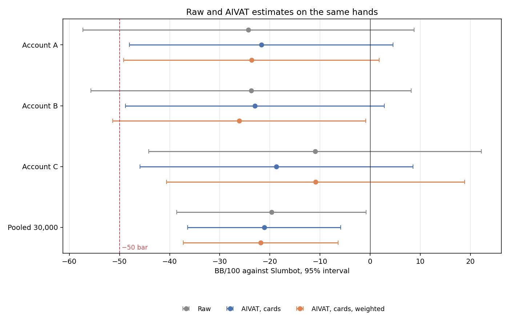
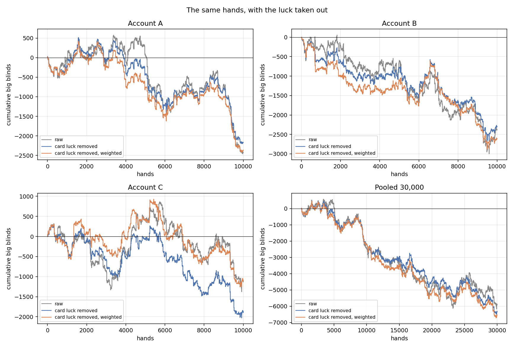
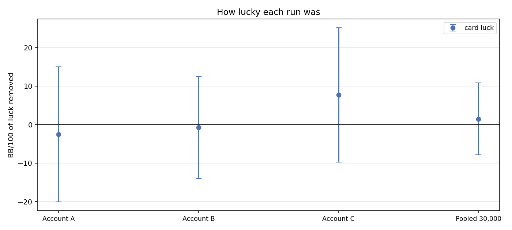
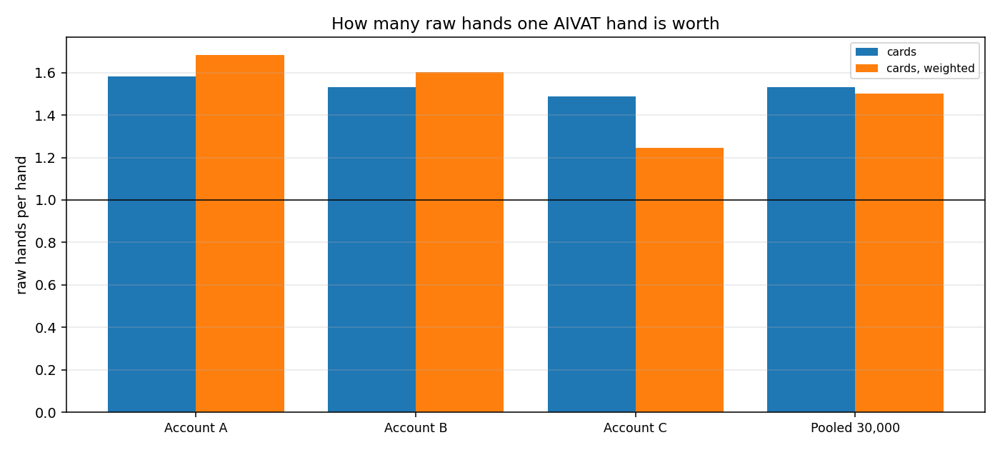
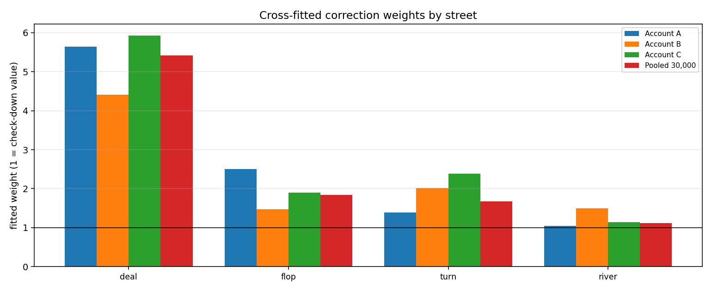
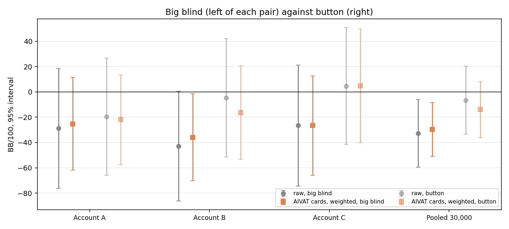

# v0.5.5 confirmation: card luck and losing public-action paths

**Both analyses and archive acceptance are complete.** Pooled card-only AIVAT is **−21.12 [−36.39, −5.84] BB/100 plain** and **−21.83 [−37.25, −6.41] weighted**, worth about **1.5 raw hands per hand**. The largest recurring loss is BB call of a 2 BB open → check-fold to a half-pot flop bet (−15.55 BB/100 over all hands).

[Protocol version 2](../hu200-v055-acceptance-protocol-v2.md) uses **raw BB/100**. The [#318 confirmation](hu200-v055-blend-confirmation.md) remains **−19.67 [−38.57, −0.76] BB/100** and its qualification verdict stands. Everything here is informational and descriptive. There is no new play, training, model loading or own-action correction.

## Inputs and method

The analysis uses the three 10,000-hand confirmation accounts, [#304’s three 10,000-hand seeds](hu200-v055-slumbot-confirmation.md), and the blend’s 10,000 exploratory hands from [#316](slumbot-aivat-real-runs.md): **70,000 distinct completed hands**. Exploratory hands never enter the confirmation pool.

The [integrity receipt](v055-confirmation-diagnostics/input-integrity.json) records archive/member checks, source hashes and every journal tail. All three indexed ZIPs match their SHA256s; every member matches its manifest; all eleven journal hash chains verify. The #316 index names the exploratory journals directly rather than an indexed journal ZIP. Its 8,300-hand verified prefix and 1,700-hand continuation were retrieved from that recorded source; the prefix matches its preservation receipt. Their ordered hand IDs, positions and winnings match #316’s archived per-hand corrections, as do the three seed runs. The three seed card-only summaries reproduce to numerical precision. Both journals are preserved in this PR’s accepted archive.

The existing `scripts.profile_slumbot_runs` tool profiles completed terminal records. The [public-action helper](v055-confirmation-diagnostics/public_tables.py) splits those events by size, position, preflop pot type and betting role. It reports final net chips, including blinds. The complete [readable tables](v055-confirmation-diagnostics/public-tables.md) and [CSV receipts](v055-confirmation-diagnostics/tables/) cover every account and comparison run.

A response opportunity is a bet/raise followed by an answer on the same flop. A re-raise creates another opportunity. Response counts therefore need not equal hand counts. Terminal flop folds and the BB first-response partitions each count a hand once; the two partitions overlap and must not be added together.

Sizes follow the profile tool: **raise beyond a call / pot after calling**, with all-ins separate. A half-pot bucket is (0.4, 0.6], the next is (0.6, 0.85], approximately pot is (0.85, 1.2], and large is (1.2, 2.5]. The inherited `<0.4` label includes exactly 0.4. The analyzer JSON’s `responses_by_bet_size` pools streets and uses a different convention for raises; it cannot by itself answer the flop question. Its `actions_by_street` and raw totals are cross-checked separately. The older analyzer JSON contains 52, 88 and 162 extra decisions from abandoned-hand prefixes in the three seed runs, and one incomplete-prefix decision in the exploratory run; the terminal-only tables consistently exclude those prefixes.

## Card-only AIVAT

Each account uses #316’s unchanged per-hand wrapper and the existing analyzer, without a model. The pool concatenates A, B, C and fits its own weights; it does not average account fits. Earlier runs use only #316’s four saved card columns. Every per-hand row matches its verified journal’s ordered hand ID, seat and raw winnings; seed summaries reproduce #316 to numerical precision.

BB/100 with nominal 95% intervals over hands. Worth is raw variance divided by adjusted variance (raw hands per analyzed hand). Cross-fitting alternates hands, fitting each evaluation half’s weights on the other half. Weighted intervals omit the dependence introduced by shared fitted weights. All estimates are retained; weighting is not selected after seeing which interval looks better.

| Run | Hands | Raw | Plain cards | Weighted cards | Worth plain / weighted |
|---|---|---|---|---|---|
| Account A | 10000 | -24.29 [-57.34, +8.77] | -21.71 [-47.99, +4.58] | -23.66 [-49.15, +1.83] | 1.58 / 1.68 |
| Account B | 10000 | -23.75 [-55.71, +8.22] | -22.97 [-48.81, +2.87] | -26.10 [-51.36, -0.85] | 1.53 / 1.60 |
| Account C | 10000 | -10.97 [-44.17, +22.22] | -18.67 [-45.89, +8.55] | -10.86 [-40.60, +18.88] | 1.49 / 1.25 |
| **Confirmation pooled** | 30000 | -19.67 [-38.57, -0.76] | -21.12 [-36.39, -5.84] | -21.83 [-37.25, -6.41] | 1.53 / 1.50 |
| Seed 1302 | 10000 | -23.07 [-56.53, +10.38] | -13.95 [-40.89, +12.99] | -11.78 [-38.15, +14.59] | 1.54 / 1.61 |
| Seed 1421 | 10000 | -10.66 [-40.53, +19.21] | -11.15 [-34.88, +12.59] | -10.72 [-33.54, +12.10] | 1.58 / 1.71 |
| Seed 1422 | 10000 | -7.87 [-39.39, +23.65] | -10.53 [-36.66, +15.59] | -5.79 [-32.11, +20.53] | 1.46 / 1.43 |
| Seeds pooled | 30000 | -13.87 [-32.14, +4.40] | -11.88 [-26.68, +2.93] | -10.95 [-25.05, +3.15] | 1.52 / 1.68 |
| Blend exploratory | 10000 | -6.79 [-39.65, +26.08] | +1.45 [-25.21, +28.10] | +9.18 [-19.31, +37.66] | 1.52 / 1.33 |

The pooled plain and weighted estimates are worth **1.53 and 1.50 raw hands per hand**, respectively. Weighting is less precise than plain cards on account C (1.25 versus 1.49), and slightly less precise in the pool. Both results are retained without changing the estimator.

The four confirmation rows, including the actual pooled fit, appear in every chart. The −50 reference is shown for context only: protocol v2 judges raw BB/100 and its verdict stands.

Cumulative curves show raw, plain cards and weighted cards. The pooled curve uses A, B, C concatenation, not a global chronological order across simultaneous accounts. The weighted curve is retrospective, using the full-sample cross-fitted weights.

### Removed card luck and the zero-mean check

Positive luck means favorable cards increased raw winnings; the correction is subtracted. The exact chance corrections have mean zero in expectation. These finite-sample intervals check compatibility with that expectation; they cannot prove absence of bias. Plain corrections, weighted corrections and their nominal intervals are reported separately.

| Run | Plain removed luck ±95% | Plain z | Weighted removed luck ±95% |
|---|---|---|---|
| Account A | -2.58 ± 17.54 | -0.29 | -0.63 ± 21.16 |
| Account B | -0.77 ± 13.20 | -0.11 | +2.36 ± 21.88 |
| Account C | +7.70 ± 17.42 | +0.87 | -0.12 ± 28.35 |
| **Confirmation pooled** | +1.45 ± 9.34 | +0.30 | +2.16 ± 12.90 |
| Seed 1302 | -9.13 ± 14.27 | -1.25 | -11.30 ± 23.81 |
| Seed 1421 | +0.49 ± 13.06 | +0.07 | +0.06 ± 20.26 |
| Seed 1422 | +2.66 ± 13.25 | +0.39 | -2.08 ± 23.56 |
| Seeds pooled | -1.99 ± 7.81 | -0.50 | -2.92 ± 11.68 |
| Blend exploratory | -8.23 ± 16.39 | -0.98 | -15.96 ± 26.45 |

Every individual and pooled removed-luck interval above includes zero. Confirmation’s plain pooled z-score is +0.30; there is no detectable nonzero average correction in this sample.

Across all **70,000 distinct hands**, plain removed card luck is **-1.41 ± 5.72 BB/100**. The two pooled rows above repeat their constituent hands and are excluded from this check.

### Fitted street weights

Both evaluation halves’ weights are below. Half 0 evaluates even-indexed hands with a fit on odd hands; half 1 reverses them. The chart displays the mean of those two fits, not a new fit. All earlier-run weights are also retained in the CSV.

| Run | Evaluation half | Deal | Flop | Turn | River |
|---|---|---|---|---|---|
| Account A | 0 | 4.509 | 2.536 | 1.391 | 1.073 |
| Account A | 1 | 6.785 | 2.479 | 1.386 | 1.020 |
| Account B | 0 | 4.255 | 0.982 | 1.839 | 1.474 |
| Account B | 1 | 4.563 | 1.954 | 2.191 | 1.510 |
| Account C | 0 | 5.845 | 1.046 | 1.751 | 0.844 |
| Account C | 1 | 6.005 | 2.750 | 3.018 | 1.428 |
| **Confirmation pooled** | 0 | 4.993 | 1.255 | 1.489 | 1.021 |
| **Confirmation pooled** | 1 | 5.855 | 2.430 | 1.860 | 1.210 |

The [seat counts within each cross-fit half](v055-confirmation-diagnostics/tables/aivat-crossfit-seats.csv) also matter when comparing runs. The unchanged analyzer alternates hands between halves; uninterrupted sessions also alternate seats. The table below records the resulting confirmation splits. Each half still uses only the other half’s fitted weights; no alternative splitter was run. In confirmation the halves coincide with seats, so a fit learned on the button evaluates BB hands, and vice versa. These coefficients describe that unchanged split rather than an optimal fit for each seat.

| Run | Evaluation half | BB hands | Button hands |
|---|---|---|---|
| Account A | 0 | 5000 | 0 |
| Account A | 1 | 0 | 5000 |
| Account B | 0 | 5000 | 0 |
| Account B | 1 | 0 | 5000 |
| Account C | 0 | 5000 | 0 |
| Account C | 1 | 0 | 5000 |
| **Confirmation pooled** | 0 | 15000 | 0 |
| **Confirmation pooled** | 1 | 0 | 15000 |

### Results by seat

These rates use hands in that seat as the denominator, unlike flop-fold contributions over all hands.

| Run | Seat | Hands | Raw | Plain cards | Weighted cards |
|---|---|---|---|---|---|
| Account A | BB | 5000 | -28.92 [-76.14, +18.30] | -22.40 [-59.95, +15.15] | -25.30 [-61.97, +11.36] |
| Account A | Button | 5000 | -19.65 [-65.92, +26.62] | -21.01 [-57.82, +15.79] | -22.02 [-57.43, +13.40] |
| Account B | BB | 5000 | -42.87 [-86.36, +0.62] | -35.67 [-71.70, +0.36] | -35.85 [-70.28, -1.43] |
| Account B | Button | 5000 | -4.62 [-51.49, +42.25] | -10.27 [-47.31, +26.77] | -16.35 [-53.32, +20.61] |
| Account C | BB | 5000 | -26.59 [-74.37, +21.19] | -26.33 [-66.15, +13.49] | -26.56 [-65.77, +12.65] |
| Account C | Button | 5000 | +4.64 [-41.46, +50.74] | -11.02 [-48.14, +26.11] | +4.84 [-39.89, +49.57] |
| **Confirmation pooled** | BB | 15000 | -32.79 [-59.47, -6.12] | -28.13 [-49.98, -6.29] | -29.69 [-51.07, -8.32] |
| **Confirmation pooled** | Button | 15000 | -6.54 [-33.34, +20.25] | -14.10 [-35.45, +7.26] | -13.96 [-36.20, +8.27] |

### Comparison with #316

Weighted confirmation minus seeds pooled: **-10.88 ± 20.90 BB/100** (nominal independent-hand difference interval).

Weighted confirmation minus blend exploratory: **-31.01 ± 32.39 BB/100** (nominal independent-hand difference interval).

Both difference intervals include zero; neither comparison establishes a change in playing strength.

#316’s headline worth of 1.3–1.8 included own-action corrections. The comparison above is **cards only throughout**, so it addresses the same estimator on every run. The exploratory weighted estimate is less precise than its plain estimate, illustrating that fitted weighting need not improve every run. No acceptance verdict or future action is chosen from these comparisons.

## What accounts for the flop-fold loss

The terminal public actions reproduce #318 exactly: **our 3,775 flop folds lose 1,161,000 chips (−38.70 BB/100)**, while **Slumbot’s 2,795 flop folds win 773,250 (+25.775 BB/100)**, net **−12.925 BB/100 over all 30,000 hands**.

Facing flop bets or raises, our responses are **53.52% fold / 37.81% call / 8.66% raise** over **7,053 opportunities**; Slumbot’s are **34.68% / 53.42% / 11.90%** over **8,059 opportunities**. The original “35% more folds” compares terminal fold counts (3,775 versus 2,795), rather than these conditional rates.

These are not matched-strategy comparisons. We and Slumbot use different bet sizes and reach different ranges and pot types. Folding more often does not by itself establish an error.

The three largest recurring groups of our flop folds are:

| Rank | Concrete path | Confirmation folds / opportunities | Loss over all hands | Earlier-run losses |
|---|---|---:|---:|---:|
| 1 | BB calls a 2 BB button open, checks, then folds to a half-pot bet | 2,333 / 4,018 | −15.55 BB/100 | −13.76 to −16.24 |
| 2 | Button faces a half-pot c-bet in a 3-bet pot | 188 / 335 | −4.60 BB/100 | −2.91 to −5.25 |
| 3 | Button limps, calls the BB’s raise to 3 BB, then folds to a half-pot c-bet | 371 / 698 | −3.71 BB/100 | −3.48 to −3.87 |

Each path appears at similar frequency in **every one of the seven individual runs**. Their combined gross loss is −23.86 BB/100; other terminal flop-fold paths net +10.94, leaving −12.925. The second group’s two main exact paths are opening to 2 BB and calling a 6 BB 3-bet (116 folds, −2.32), and opening to 3 BB and calling a 9 BB 3-bet (70 folds, −2.10). The remaining two folds are in other 3-bet-or-larger pots.

The [flop response tables](v055-confirmation-diagnostics/public-tables.md) give fold/call/raise shares for both players, every observed size and both positions. The [fine table](v055-confirmation-diagnostics/tables/flop-responses.csv) further separates single-raised, limped and 3-bet-or-larger pots, continuation bets, non-aggressor bets and raises. By size, terminal flop folds net **−28.95 BB/100 against half-pot bets**, offset by **+11.13** below or equal to 0.4 pot and **+8.76** near pot; all other sizes net **−3.86**, giving −12.925 overall. Slumbot’s folds against our smaller and pot-sized bets offset much of the loss against its half-pot bets. Those different mixes prevent a direct “excess folds at equal ranges” interpretation.

## Big blind: opening sizes and response outcomes

Slumbot **always opens to 2 BB when it enters from the button** in all seven runs: no limp and no other open size. In the confirmation it opens 13,535 of 15,000 buttons (90.23%) and folds the other 1,465.

| Our first BB response | Hands | Share facing a 2 BB open | Final net chips | Chips per selected hand | Adds BB/100 over BB hands |
|---|---:|---:|---:|---:|---:|
| Fold | 2,417 | 17.86% | −241,700 | −100.00 | −16.11 |
| Call | 7,991 | 59.04% | −501,300 | −62.73 | −33.42 |
| Raise | 3,127 | 23.10% | +177,850 | +56.88 | +11.86 |
| Slumbot folds; no response | 1,465 | — | +73,250 | +50.00 | +4.88 |
| **All BB hands** | **15,000** | | **−491,900** | **−32.79** | **−32.79** |

The call group loses in every run, contributing −14.41 to −43.94 BB/100 over BB hands. Its confirmation conditional mean is **−62.73 ± 23.56 chips per call hand**. That is less loss than folding’s posted 100 chips, but selected ranges differ: it is not a counterfactual comparison of actions. Raise outcomes vary in sign (seed 1302 loses); these tables do not show that raising more would help.

**Preflop endings almost balance:** our preflop folds contribute −20.33 BB/100 over BB hands, and Slumbot’s preflop folds +20.46, net **+0.12**. Hands continuing past preflop contribute **−32.92**: our later folds −125.32, Slumbot’s later folds +96.86, showdowns −4.45. This allocates final outcomes by where a hand ends, including its preflop investment; it is not a causal assignment of losses to streets.

Among the 7,991 initial calls, our flop folds contribute −34.45 BB/100 over BB hands, turn folds −20.74 and river folds −26.99. Slumbot’s folds and showdowns offset those gross losses. The largest BB call/check-fold path is the same path ranked first above, so those numbers overlap.

## Ranked targets for future diagnosis

1. **BB call of the 2 BB open → check facing the half-pot c-bet.** This is the largest specific recurring terminal loss and sits inside the largest losing BB response group. Examine its range and continuation support before proposing search or training changes.
2. **Button calls a 3-bet → faces a half-pot flop c-bet.** It is less frequent but loses 6–9 BB on most folds. Both principal preflop sizes recur across seeds and blend accounts.
3. **Button limp-call of a 3 BB isolation raise → faces a half-pot flop c-bet.** This is a separate, stable path with a narrow and repeatable monetary contribution.

These are descriptions of where chips leave the observed samples. No alternative action has been evaluated, no fix is claimed, and rare one-run paths are not promoted into findings. The full [consistency table](v055-confirmation-diagnostics/public-tables.md#consistency-of-the-largest-specific-flop-fold-paths) retains all runs, including variation in BB raises and showdowns.

## Reproduction and evidence

The [reproduction commands](v055-confirmation-diagnostics/REPRODUCE.md), [input integrity receipt](v055-confirmation-diagnostics/input-integrity.json), compact `cards-*.json` summaries and [reconciliation tables](v055-confirmation-diagnostics/tables/decision-reconciliation.csv) retain the analysis methods and checks. Every confirmation account has 10,000 saved corrections, and the pool has 30,000. The profile CLI, public tables and analyzer raw totals reconcile; older abandoned-prefix action differences are recorded explicitly. All six charts have been visually inspected.

The larger evidence includes raw journals, every per-hand correction, input archives, source provenance, failures and reproduction logs. The [accepted storage receipt](v055-confirmation-diagnostics/storage.json) and [research index](../../RESULTS_INDEX.md) pin both archives and restoration paths. The complete uncompressed evidence has **414/414 files covered**, with zero uncovered or changed files. The main ZIP retains the large evidence; the small closeout ZIP supplies three nested input manifests and upload-attempt receipts. Acceptance compares Drive MD5/size, alongside local SHA256/member readback; the remote archives were not downloaded again. The initial launcher failure produced no corrections; its traceback and successful smoke check are preserved, along with the recovered transfer-connection failure. The PR records plumbing failures as they occur. The owner decides merge.
